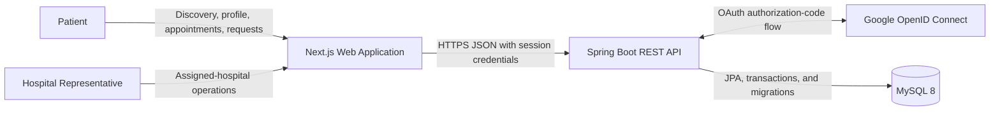
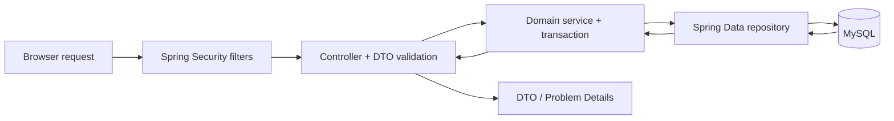
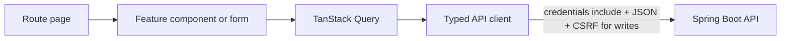
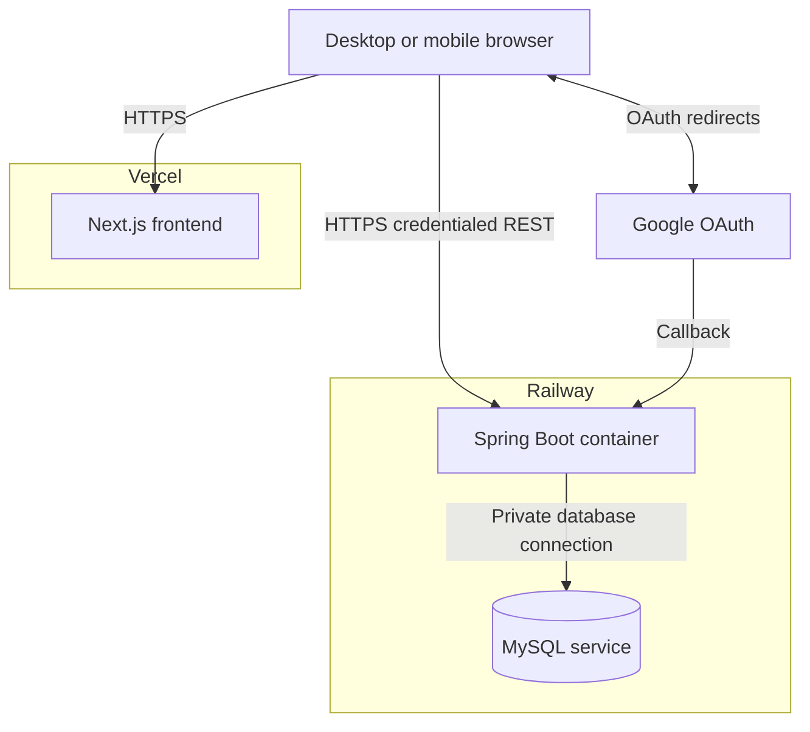
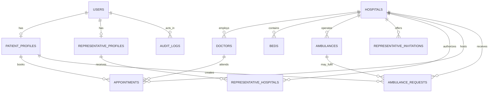
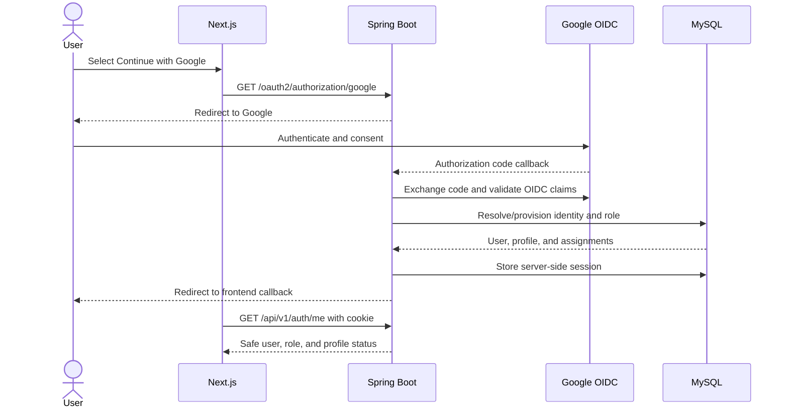
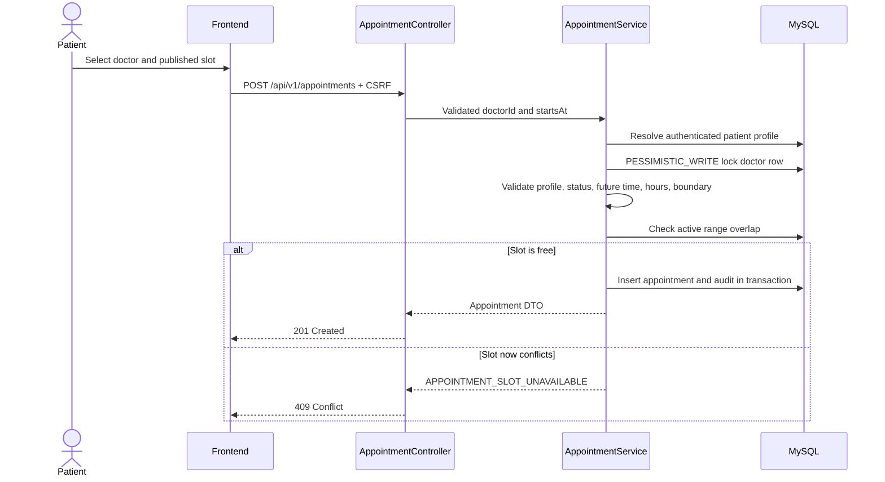

# VitaNova Connect — Complete Project Documentation

> **Project:** Medical Aid Tracker  
> **Product name:** VitaNova Connect  
> **Document type:** Complete engineering, implementation, and viva report  
> **Version:** 1.0  
> **Last implementation verification:** 23 July 2026  
> **Current status:** Implemented and locally verified; cloud deployment configuration is ready, but no public Vercel/Railway deployment has been completed yet.

---

## Table of contents

1. [Abstract](#1-abstract)
2. [Purpose, motivation, and problem statement](#2-purpose-motivation-and-problem-statement)
3. [Project objectives and outcomes](#3-project-objectives-and-outcomes)
4. [Scope, users, and functional requirements](#4-scope-users-and-functional-requirements)
5. [Original project analysis](#5-original-project-analysis)
6. [Modernization strategy](#6-modernization-strategy)
7. [System architecture](#7-system-architecture)
8. [Complete technology and tool inventory](#8-complete-technology-and-tool-inventory)
9. [Repository and folder structure](#9-repository-and-folder-structure)
10. [Backend implementation](#10-backend-implementation)
11. [Frontend and UI/UX implementation](#11-frontend-and-uiux-implementation)
12. [Database design](#12-database-design)
13. [Authentication, authorization, and security](#13-authentication-authorization-and-security)
14. [REST API](#14-rest-api)
15. [Important business logic and workflows](#15-important-business-logic-and-workflows)
16. [Validation, errors, logging, and audit](#16-validation-errors-logging-and-audit)
17. [Testing and quality assurance](#17-testing-and-quality-assurance)
18. [Deployment and operations](#18-deployment-and-operations)
19. [Implementation strategy and completed work](#19-implementation-strategy-and-completed-work)
20. [Challenges faced and how they were overcome](#20-challenges-faced-and-how-they-were-overcome)
21. [Technology alternatives and decision rationale](#21-technology-alternatives-and-decision-rationale)
22. [Local installation and run guide](#22-local-installation-and-run-guide)
23. [Known limitations and future scope](#23-known-limitations-and-future-scope)
24. [Viva presentation guide](#24-viva-presentation-guide)
25. [Conclusion](#25-conclusion)
26. [Documentation map](#26-documentation-map)

---

## 1. Abstract

VitaNova Connect is a role-based healthcare coordination web application built
as the modern version of an original Java, JDBC, MySQL, console, and partial
JavaFX Medical Aid Tracker. It allows patients to discover doctors, review
reported hospital-bed and ambulance availability, manage a profile, book and
cancel appointments, and submit ambulance-support requests. It also provides a
separate operational portal through which authorized hospital representatives
can manage doctor availability, bed status, and appointments only for hospitals
assigned to them.

The modernization preserves the original project's Java, SQL, relational
database, joins, constraints, indexing, and transaction learning outcomes while
adding a professional web architecture. The implemented system uses a Next.js
and TypeScript frontend, a Java 21 and Spring Boot REST backend, MySQL 8, Flyway
migrations, Google OpenID Connect, database-backed sessions, role-based
authorization, responsive UI components, validation, safe error handling,
audit history, automated tests, container configuration, CI, and cloud
deployment configuration.

The application is deliberately a **modular monolith**: one frontend, one
backend, and one relational database. This provides industry-style separation
of concerns without adding microservices, message brokers, Kubernetes, or other
complexity that is unnecessary for a final-year student project.

> **Safety statement:** VitaNova Connect is an educational coordination
> application using demonstration data. It is not a hospital information system,
> emergency dispatch service, clinical decision system, or guarantee of
> treatment, admission, ambulance response, or real-time availability.

---

## 2. Purpose, motivation, and problem statement

### 2.1 Motivation

Healthcare information is often fragmented across telephone calls, individual
hospital desks, and disconnected records. A patient may need a clearer way to:

- find an appropriate doctor;
- understand the doctor's reported availability and working hours;
- identify a hospital reporting an available ICU or general bed;
- organize appointments and cancellation history;
- find reported ambulance services and record a support request.

Hospitals also need a controlled way for authorized staff to keep operational
availability data current without exposing every hospital's data to every
representative.

The project was therefore motivated by two goals:

1. solve a realistic information-coordination problem through a simple web
   application; and
2. demonstrate the practical application of Java, DBMS, SQL, REST, security,
   frontend engineering, testing, and deployment concepts in one explainable
   final-year project.

### 2.2 Original problem

The original implementation was a useful academic prototype, but it was not
suitable for public or multi-user operation:

- it ran as a console or local JavaFX application;
- database access was performed directly through static JDBC methods;
- a login screen accepted non-empty values but did not establish a verified
  identity or secure role;
- role selection and authorization were not server-enforced;
- schema and column names differed between Java files and the SQL dump;
- some operations deleted historical records;
- credentials were embedded in legacy source before sanitization;
- there was no REST boundary, responsive web UI, session management, automated
  migration, CI pipeline, or deployment configuration;
- raw database exceptions could be shown directly to a user.

Evidence of the original design is intentionally retained in
[`legacy/`](../legacy/README.md) for comparison and viva demonstration.

### 2.3 Problem statement

The project addresses the following formal problem:

> Design and implement a secure, responsive, role-based medical-aid coordination
> application that allows patients to discover reported care resources and
> manage their own requests, while allowing representatives to update only their
> assigned hospitals, with relational integrity, transactional appointment
> booking, auditable changes, maintainable code, and reproducible deployment.

### 2.4 Why the project is academically valuable

The solution demonstrates:

- normalization and relational modelling;
- primary, foreign, unique, and composite keys;
- one-to-one, one-to-many, and many-to-many relationships;
- joins, filtering, aggregation, pagination, and indexing;
- transaction isolation, pessimistic locking, and optimistic versioning;
- OAuth authentication versus application authorization;
- session, cookie, CORS, and CSRF security;
- REST resource design and HTTP status semantics;
- client/server validation and safe errors;
- responsive component-based frontend engineering;
- automated unit/integration checks and CI;
- environment-based configuration, containers, and deployment planning.

---

## 3. Project objectives and outcomes

### 3.1 Primary objectives

- Preserve the useful healthcare-discovery and appointment concepts from the
  original project.
- Retain Java and MySQL as central technologies.
- Replace the desktop-only interface with a responsive web experience.
- Introduce verified Google sign-in and secure database-owned roles.
- Create separate patient and representative portals.
- Enforce patient ownership and representative hospital scope in the backend.
- Replace static JDBC application code with layered, transaction-aware services.
- Establish one canonical, versioned database schema.
- Add structured validation, errors, logging, and audit records.
- Make the application testable, reproducible, and deployment-ready.
- Keep the architecture understandable for a student team and final viva.

### 3.2 Implemented outcomes

| Area | Before modernization | Implemented outcome |
|---|---|---|
| User interface | Console and partial JavaFX | Responsive Next.js web application |
| Authentication | Placeholder/non-empty login | Google OAuth 2.0/OpenID Connect through Spring Security |
| Authorization | Menu/role selection | Database role, ownership checks, and hospital assignments |
| Backend | Static JDBC methods | Layered Spring Boot REST modular monolith |
| Persistence | Manual connections and `ResultSet` values | JPA entities, repositories, DTOs, and transactions |
| Schema | Inconsistent SQL/Java naming | Flyway-managed canonical MySQL schema |
| Appointment cancellation | Row deletion in legacy flows | Status transition with reason, timestamp, and history |
| Double booking | Check then insert without locking | Doctor-row pessimistic lock and overlap recheck in one transaction |
| Configuration | Embedded/local values | Environment variables and validated configuration |
| Errors | Raw or inconsistent messages | Safe RFC Problem Details-style responses |
| Sessions | None | MySQL-backed Spring Session with an HttpOnly cookie |
| Frontend state | Not applicable | TanStack Query server-state cache and local component state |
| Documentation | Original code and diagrams | Architecture, schema, API, security, test, deployment, and viva guides |
| Delivery | Manual desktop execution | Maven/npm builds, Dockerfiles, Compose, CI, Vercel/Railway configuration |

### 3.3 Current delivery status

The implementation and local quality gates are complete. The repository contains
production configuration for a Vercel frontend, Railway backend, and MySQL
database. A public deployment has **not** been completed because deployment
accounts, production domains, and production Google OAuth credentials must be
owned and configured by the project owner.

This distinction is important:

- **deployment-ready** means code and configuration exist and build;
- **deployed** means a live, verified public environment exists.

At the time of this document, the first statement is true and the second is not.

---

## 4. Scope, users, and functional requirements

### 4.1 User roles

#### Patient

A patient can:

- sign in using a verified Google account;
- complete and update a personal profile;
- search doctors by text, specialization, hospital, availability, and bed
  context;
- inspect a doctor's hospital, hours, and generated appointment slots;
- search hospitals reporting ICU or general-bed availability and available
  doctors;
- book a valid future appointment;
- view only their own appointment timeline;
- cancel only their own future booked appointment with a reason;
- view reported ambulance records;
- create a hospital-specific ambulance-support request;
- view only their own request history.

#### Representative

A representative can:

- sign in using an invited Google account;
- access a separate operational dashboard;
- see metrics only for assigned hospitals;
- list and update assigned-hospital doctors;
- list and update assigned-hospital beds;
- view appointments only for assigned hospitals;
- cancel an assigned-hospital appointment with a recorded reason;
- maintain representative profile details.

Representative access is not selected in the browser. It is created through a
controlled invitation and hospital-assignment process.

### 4.2 Delivered screens

#### Public

- Landing page
- Login page
- OAuth callback page
- Global error page
- Branded not-found page

#### Patient portal

- Dashboard
- Onboarding
- Doctor search
- Doctor detail and booking
- Emergency-bed search
- Appointments
- Ambulances and request history
- Profile

#### Representative portal

- Dashboard
- Doctors
- Beds
- Appointments
- Profile

### 4.3 Explicit non-goals

The project intentionally does not provide:

- diagnosis, treatment advice, prescriptions, or electronic health records;
- payments, insurance, or billing;
- live GPS tracking or real emergency dispatch;
- automatic ambulance assignment/status transitions;
- a public administrator dashboard;
- self-service representative registration;
- hospital-system integration or guaranteed real-time data;
- formal HIPAA, GDPR, or healthcare compliance certification;
- microservices, event sourcing, message brokers, or Kubernetes.

Defining these non-goals prevents unsafe claims and keeps the final-year scope
realistic.

---

## 5. Original project analysis

### 5.1 Legacy artifacts

| Legacy file | Original responsibility | Modern status |
|---|---|---|
| [`legacy/med_aid_track.java`](../legacy/med_aid_track.java) | Console menus, search, booking, patient, bed, doctor, and deletion operations | Replaced; retained for design history |
| [`legacy/MedicalAidTracker.java`](../legacy/MedicalAidTracker.java) | Reusable static JDBC queries for JavaFX UI | Replaced |
| [`legacy/CityHospitalManagementLogin.java`](../legacy/CityHospitalManagementLogin.java) | Early JavaFX login and care-search interface | Replaced |
| [`legacy/data.sql`](../legacy/data.sql) | Original MySQL tables and seed records | Analysed, sanitized, and selectively migrated |
| `legacy/*.drawio*` | Original ER modelling | Superseded by the current schema diagram |

The modern build does not compile or execute anything in `legacy/`.

### 5.2 Strengths retained from the original project

- A relevant healthcare-resource discovery problem.
- Patient and representative use-case separation.
- Java and JDBC understanding.
- SQL joins and parameterized statements in several flows.
- Doctors, hospitals, beds, appointments, patients, and ambulances as core
  concepts.
- Working hours, availability states, and appointment-conflict intent.
- Original ER and dataset work as evidence of iterative development.

### 5.3 Weaknesses and technical debt discovered

#### Architecture

- UI, database, and business logic were tightly coupled.
- Large classes contained menu handling, SQL, input parsing, and business rules.
- Static methods made dependencies and tests difficult to isolate.
- `ResultSet` objects crossed application boundaries and kept resources open.

#### Security

- Login did not verify a real user identity.
- Roles could be selected rather than securely assigned.
- There was no resource ownership or hospital-scope enforcement.
- A JDBC credential had been embedded in old source and required redaction and
  rotation.
- Raw exception messages could reveal implementation details.

#### Database

- Table/column names differed across Java implementations and the SQL dump.
- Some queries referred to tables or fields that did not exist in the supplied
  schema.
- Appointment dates included anomalous historical data.
- Deletes could cascade through valuable history.
- There was no migration history or reproducible clean-database setup.

#### Business logic

- Check-then-insert booking could race under concurrent requests.
- Cancellation could delete records instead of recording a lifecycle event.
- Client input supplied identifiers that should have come from authenticated
  context.
- Ambulance request intent existed without a consistent request table/workflow.

#### Operations

- No environment-variable strategy.
- No health endpoint, container build, CI, cloud configuration, or production
  profile.
- No automated test suite or generated API contract.

### 5.4 Technical-debt resolution principle

Not every old line was translated. The domain intent and valid reference data
were retained, while unsafe coupling, inconsistent schema assumptions, placeholder
authentication, and destructive operations were replaced by a clean canonical
implementation.

---

## 6. Modernization strategy

### 6.1 What was retained

- Java as the backend language.
- MySQL and relational DBMS concepts.
- The hospital, doctor, bed, patient, appointment, and ambulance domain.
- Doctor specialization and working-hours concepts.
- Patient discovery and representative operational workflows.
- Sanitized reference-data intent from the original SQL.
- Legacy artifacts as evidence of project evolution.

### 6.2 What was refactored

- Direct SQL search logic became repository queries and service methods.
- Patient data was separated from authentication identity.
- Representative access became an explicit many-to-many hospital assignment.
- Appointment cancellation became a state transition.
- Date and time values became timezone-aware API values backed by UTC `Instant`
  persistence.
- Search results became paginated typed response DTOs.
- Availability counts became database aggregates.
- Configuration moved to environment-backed Spring properties.

### 6.3 What was rewritten

- All runtime frontend functionality.
- Authentication and session handling.
- REST controllers and JSON contracts.
- Service-layer business rules and authorization.
- JPA entities and repositories.
- The canonical schema and migrations.
- Responsive layouts and design-system components.
- Error handling, audit logging, automated tests, containers, and CI.

### 6.4 What was removed from the runtime

- Console menus.
- JavaFX screens.
- Placeholder role/login selection.
- Hard-coded credentials.
- Direct exposure of `ResultSet`.
- Ad hoc connection lifecycle management.
- Destructive appointment cancellation.
- Inconsistent schema/table references.
- Any dependency from modern code to legacy classes.

### 6.5 Strategy used to avoid over-engineering

- One backend rather than multiple services.
- One relational database rather than separate databases per feature.
- Package-by-feature organization without a multi-module Maven build.
- REST rather than both REST and GraphQL.
- Handwritten DTO mapping rather than another mapping framework.
- TanStack Query plus local React state rather than a second global state store.
- A small local component system rather than publishing a design-system package.
- Controlled SQL representative provisioning instead of a large admin module.
- Standard logs and platform health checks rather than a full observability stack.

---

## 7. System architecture

### 7.1 Architectural style

VitaNova Connect is a **three-tier modular monolith**:

1. **Presentation tier:** Next.js and React web client.
2. **Application tier:** Spring Boot REST API and security layer.
3. **Data tier:** MySQL database managed by Flyway and accessed through JPA.

The frontend and backend are separate deployable applications, while the backend
itself remains one cohesive service.

### 7.2 System context



### 7.3 Backend request flow



Layer responsibilities:

- **Security:** authentication, route roles, CSRF, CORS, and safe authentication
  failures.
- **Controller:** routes, parameters, validation trigger, response status, and
  DTO boundary.
- **Service:** business rules, ownership/scope decisions, transactions, and
  audit decisions.
- **Repository:** parameterized persistence and aggregate/filter queries.
- **Entity:** relational mapping and version fields.
- **Exception handler:** conversion of known/unexpected failures to safe client
  responses.

### 7.4 Frontend data flow



### 7.5 Deployment topology



The browser never connects directly to MySQL and never receives a database or
Google client secret.

### 7.6 Architecture decision principles

- Backend authorization is authoritative; hidden frontend buttons are only UX.
- Patient identity is derived from the session, never trusted from request data.
- Representative scope is checked against database assignments for every target.
- Entities do not become API contracts.
- Multi-step writes occur within transactions.
- Database changes are migration-owned; Hibernate validates rather than updates.
- Dependencies are added only when they solve an implemented requirement.

---

## 8. Complete technology and tool inventory

Versions below are taken from the current project configuration or lockfile.
Spring starter transitive versions are managed by the Spring Boot `3.5.16` BOM.

### 8.1 Frontend runtime technologies

| Technology | Current version | Purpose and use case | Why it was selected | Principal files |
|---|---:|---|---|---|
| Next.js | `16.2.11` | File-based App Router, layouts, metadata, error boundaries, route build, and Vercel integration | Provides a polished React framework and direct Vercel deployment without building routing/tooling manually | `frontend/app/**`, `frontend/next.config.mjs`, `frontend/proxy.ts`, `frontend/vercel.json` |
| React | `19.2.8` resolved | Component rendering, hooks, forms, responsive interactions, contexts, and modal state | Mature component model and native fit with Next.js | `frontend/app/**`, `frontend/components/**`, `frontend/features/**` |
| React DOM | `19.2.8` resolved | Browser rendering runtime for React | Required browser renderer for React/Next.js | `frontend/package.json`, `frontend/package-lock.json` |
| TypeScript | `5.9.3` resolved | Static types for pages, API contracts, components, enums, and filters | Prevents many integration mistakes and makes the REST contract easier to explain and maintain | `frontend/types/api.ts`, all `.ts`/`.tsx`, `frontend/tsconfig.json` |
| TanStack React Query | `5.101.4` resolved | Remote-state fetching, caching, loading/error state, cancellation, mutations, and cache invalidation | Avoids custom cache/loading code; better fit than Redux for server-owned data | `frontend/components/providers.tsx`, `frontend/features/**`, route pages, `frontend/lib/query-keys.ts` |
| Zod | `3.25.76` resolved | Client-side profile-form schema validation and field errors | Small, TypeScript-friendly validation without introducing a full form framework | `frontend/features/profile/profile-form.tsx` |
| Tailwind CSS | `3.4.19` resolved | Responsive utility styling and consistent visual composition | Rapid custom UI with a small local design system and no opinionated prebuilt visual identity | `frontend/tailwind.config.ts`, `frontend/app/globals.css`, JSX class names |
| Lucide React | `0.468.0` | Consistent accessible SVG iconography | Lightweight, coherent icons without maintaining custom SVG files | Page, feature, and component `.tsx` files |

### 8.2 Frontend build, test, and quality tools

| Tool | Current version | Purpose | Where used |
|---|---:|---|---|
| Node.js | `22` project baseline | Executes Next.js, npm scripts, lint, tests, and builds | `.nvmrc`, `frontend/Dockerfile`, `.github/workflows/ci.yml` |
| npm | Lockfile v3 workflow | Reproducible dependency installation with `npm ci` | `frontend/package-lock.json`, Dockerfile, CI, Vercel config |
| ESLint | `9.39.5` resolved | Static quality checks with zero warnings allowed | `frontend/eslint.config.mjs`, `npm run lint` |
| Next Core Web Vitals rules | `16.2.11` | React/Next.js correctness and performance linting | `frontend/eslint.config.mjs` |
| PostCSS | `8.5.22` resolved | CSS processing pipeline used by Tailwind | `frontend/postcss.config.mjs`, package overrides |
| Autoprefixer | `10.5.4` resolved | Adds compatible browser CSS prefixes | `frontend/postcss.config.mjs` |
| Vitest | `3.2.7` resolved | Fast unit tests for the API client and utilities | `frontend/vitest.config.ts`, `frontend/lib/*.test.ts` |
| Testing Library | React `16.3.2`, jest-dom `6.9.1` resolved | User-oriented component assertion support | `frontend/vitest.setup.ts`; prepared for component tests |
| jsdom | `26.1.0` resolved | Browser-like DOM environment for Vitest | `frontend/vitest.config.ts` |
| Sharp override | `0.35.0` | Patched image-processing transitive dependency | `frontend/package.json`, `frontend/package-lock.json` |

### 8.3 Backend runtime technologies

| Technology | Version | Purpose and use case | Why it was selected | Principal files |
|---|---:|---|---|---|
| Java | `21` | Backend language, records, time API, domain and transaction logic | Preserves the original Java objective while using a current LTS baseline | `.java-version`, `backend/src/main/java/**`, `backend/pom.xml` |
| Spring Boot | `3.5.16` | Application bootstrap, dependency configuration, production profiles, embedded server, and starter ecosystem | Reduces infrastructure boilerplate while retaining explicit domain code | `backend/pom.xml`, `MedicalAidTrackerApplication.java`, resource YAML files |
| Spring Web MVC | Boot-managed | REST controllers, JSON serialization, request mapping, status codes, and exception advice | Mature servlet REST stack that integrates directly with validation and security | All `*Controller.java`, `GlobalExceptionHandler.java` |
| Spring Data JPA / Hibernate | Boot-managed | Entity mapping, repository queries, parameter binding, pagination, locks, and transactions | Replaces repeated JDBC plumbing while preserving relational modelling and query knowledge | Domain entities/repositories/services, `application.yml` |
| Spring Security | Boot-managed | Security filter chain, RBAC, CORS, CSRF, logout, `401`, and `403` behavior | Avoids unsafe custom authentication filters and integrates with OAuth/session infrastructure | `config/SecurityConfig.java`, `security/**` |
| Spring OAuth2 Client | Boot-managed | Google authorization-code/OpenID Connect login | Keeps authentication inside the Java backend that protects the API | `SecurityConfig.java`, `OAuthGrantedAuthoritiesMapper.java`, `OAuthAccountService.java` |
| Jakarta Validation | Boot-managed | DTO and configuration constraints | Provides authoritative server validation even when the UI is bypassed | DTO records, `AppProperties.java`, controller `@Valid` |
| Spring Session JDBC | Boot-managed | Server-side session persistence in MySQL | Supports invalidation and backend restart/multiple-instance continuity without browser-stored bearer tokens | `application.yml`, V1 session tables, `SecurityConfig.java` |
| Flyway Core/MySQL | Boot-managed | Ordered schema creation, seed data, and forward migrations | Reproducible database state and safer evolution than manual SQL or `ddl-auto=update` | `backend/src/main/resources/db/migration/**` |
| MySQL Connector/J | Boot-managed | Java-to-MySQL JDBC driver beneath JPA | Official runtime driver for the selected database | `backend/pom.xml`, datasource configuration |
| Spring Boot Actuator | Boot-managed | Health, readiness, information, and controlled metrics endpoints | Enables deployment health checks without a large monitoring platform | `application.yml`, Docker/Railway health checks |
| Springdoc OpenAPI | `2.8.14` | Generated OpenAPI JSON and Swagger UI | Makes the API demonstrable and testable in the viva | `config/OpenApiConfig.java`, `application.yml` |
| Lombok | Boot-managed | Constructor, getter/setter, logging, and builder boilerplate reduction | Keeps entity/service code concise while domain decisions remain visible | Java classes using Lombok annotations, compiler configuration |
| SLF4J + Logback | Boot-managed | Timestamped application, error, and audit logging | Standard Spring logging facade/runtime with platform stdout compatibility | `AuditService.java`, `GlobalExceptionHandler.java`, `application.yml` |
| HikariCP | Boot-managed | Bounded JDBC connection pool | Spring Boot default high-quality pool with configurable sizing/timeouts | Datasource section of `application.yml` |

### 8.4 Database technologies and concepts

| Technology/concept | Purpose | Where used |
|---|---|---|
| MySQL 8.4 | Production/local relational database | `compose.yaml`, datasource configuration, Railway plan |
| SQL DDL/DML | Tables, keys, constraints, indexes, and sanitized reference data | `backend/src/main/resources/db/migration/*.sql` |
| Foreign keys | Preserve users/profiles/hospitals/doctors/beds/appointments/request relationships | `V1__create_core_schema.sql` |
| Unique/composite keys | Protect identity, assignments, bed codes, invitation pairs, and vehicle numbers | V1 migration |
| Indexes | Support search, availability aggregates, timelines, scope queries, conflicts, audit, and sessions | V1 migration |
| Transactions | Keep booking, cancellation, provisioning, updates, and audit writes consistent | Service methods annotated `@Transactional` |
| Pessimistic lock | Serializes competing booking operations by doctor | `DoctorRepository.findByIdForUpdate`, `AppointmentService.book` |
| Optimistic versioning | Detects concurrent updates to operational entities | `@Version` in `Doctor`, `Bed`, `Ambulance`, and `Appointment` |
| UTC persistence/timezone conversion | Prevents inconsistent appointment timestamps | `application.yml`, appointment/ambulance services |

### 8.5 Backend build and testing tools

| Tool | Version/baseline | Purpose | Where used |
|---|---:|---|---|
| Maven | `3.9.16` distribution | Dependency resolution, compilation, tests, JAR packaging | `backend/mvnw`, wrapper properties, `pom.xml` |
| Maven Wrapper | Wrapper bootstrap `3.3.4` | Reproducible Maven execution without a separate Maven installation | `backend/.mvn/wrapper/maven-wrapper.properties` |
| JUnit 5 | Boot-managed | Backend test framework | `backend/src/test/java/**` |
| Spring Boot Test / MockMvc | Boot-managed | Application-context, REST, repository, security, and integration tests | Integration test classes |
| Spring Security Test | Boot-managed | Authenticated role principals and security assertions | Security and web tests |
| H2 | Boot-managed test dependency | Fast in-memory integration database in MySQL compatibility mode | `pom.xml`, `application-test.yml` |
| Mockito / Byte Buddy | Boot-managed | Test doubles and compatible Java-agent setup | Spring test stack, Surefire configuration |
| Maven Surefire | `3.5.6` in verified run | Executes the JUnit platform | `pom.xml`, Maven build |

### 8.6 Delivery, deployment, and engineering tools

| Tool | Purpose and application | Principal files |
|---|---|---|
| Google Cloud OAuth client | Creates the web OAuth client ID/secret and exact authorized callback | Backend environment variables and Google Cloud Console |
| Docker | Multi-stage reproducible frontend/backend images with non-root runtime users | `frontend/Dockerfile`, `backend/Dockerfile` |
| Docker Compose | Starts MySQL, backend, and frontend as one local environment with health dependencies | `compose.yaml` |
| Vercel | Intended production host for the Next.js frontend in Mumbai region | `frontend/vercel.json` |
| Railway | Intended backend container and MySQL host with health-based restarts | `backend/railway.toml`, deployment guide |
| GitHub Actions | CI for backend verification plus frontend install, lint, typecheck, tests, and build | `.github/workflows/ci.yml` |
| Dependabot | Monthly npm, Maven, and GitHub Actions dependency updates | `.github/dependabot.yml` |
| Make | Short aliases for common local development and verification commands | `Makefile` |
| Environment files | Separates local/production configuration and secrets from source | `.env.example`, `backend/.env.example`, `frontend/.env.example`, `.gitignore` |
| EditorConfig | Consistent charset, line endings, whitespace, and indentation | `.editorconfig` |
| Java/Node version pins | Align local and CI toolchains | `.java-version`, `.nvmrc` |
| OpenAPI/Swagger UI | Interactive API inspection at runtime | `/v3/api-docs`, `/swagger-ui.html` |
| Social-preview image generation | Produced the non-clinical Open Graph visual asset used by page metadata; it is not a runtime dependency | `frontend/public/og.png`, `frontend/app/layout.tsx` |

---

## 9. Repository and folder structure

```text
Medical_Aid_Tracker-main/
├── .github/
│   ├── workflows/
│   │   └── ci.yml
│   └── dependabot.yml
├── backend/
│   ├── .mvn/wrapper/
│   ├── scripts/
│   │   └── provision-representative.sql
│   ├── src/
│   │   ├── main/
│   │   │   ├── java/com/medicalaidtracker/
│   │   │   │   ├── ambulance/
│   │   │   │   ├── appointment/
│   │   │   │   ├── audit/
│   │   │   │   ├── bed/
│   │   │   │   ├── common/
│   │   │   │   ├── config/
│   │   │   │   ├── doctor/
│   │   │   │   ├── hospital/
│   │   │   │   ├── representative/
│   │   │   │   ├── security/
│   │   │   │   ├── user/
│   │   │   │   └── MedicalAidTrackerApplication.java
│   │   │   └── resources/
│   │   │       ├── db/migration/
│   │   │       │   ├── V1__create_core_schema.sql
│   │   │       │   ├── V2__seed_reference_data.sql
│   │   │       │   └── V3__require_ambulance_hospital.sql
│   │   │       ├── application.yml
│   │   │       └── application-prod.yml
│   │   └── test/
│   │       ├── java/com/medicalaidtracker/
│   │       └── resources/application-test.yml
│   ├── .env.example
│   ├── Dockerfile
│   ├── mvnw
│   ├── pom.xml
│   └── railway.toml
├── frontend/
│   ├── app/
│   │   ├── (public)/
│   │   ├── auth/callback/
│   │   ├── login/
│   │   ├── patient/
│   │   ├── representative/
│   │   ├── error.tsx
│   │   ├── globals.css
│   │   ├── layout.tsx
│   │   └── not-found.tsx
│   ├── components/
│   │   ├── ui/
│   │   └── shared application components
│   ├── features/
│   │   ├── ambulances/
│   │   ├── appointments/
│   │   ├── auth/
│   │   ├── doctors/
│   │   ├── profile/
│   │   └── representative/
│   ├── lib/
│   ├── public/
│   │   └── og.png
│   ├── types/
│   │   └── api.ts
│   ├── .env.example
│   ├── Dockerfile
│   ├── package.json
│   ├── package-lock.json
│   ├── next.config.mjs
│   ├── tailwind.config.ts
│   ├── tsconfig.json
│   ├── vercel.json
│   └── vitest.config.ts
├── docs/
│   ├── PROJECT_DOCUMENTATION.md
│   ├── api.md
│   ├── architecture.md
│   ├── database-schema.md
│   ├── deployment.md
│   ├── installation.md
│   ├── modules.md
│   ├── security.md
│   ├── testing.md
│   └── viva-guide.md
├── legacy/
├── .editorconfig
├── .env.example
├── .gitignore
├── .java-version
├── .nvmrc
├── compose.yaml
├── Makefile
└── README.md
```

### 9.1 Organization rules

- Backend packages are organized by feature rather than by one global
  `controller/service/repository` folder.
- Small modules contain only the layers they need; empty interfaces are not
  created for architectural appearance.
- Shared frontend presentation primitives live in `components/ui`.
- Domain-aware frontend behavior lives in `features`.
- Routes and role layouts live in the Next.js `app` tree.
- All network behavior is centralized in `frontend/lib/api.ts`.
- Public frontend types describe the REST contract, not JPA entities.
- `legacy/` is historical and never imported by modern code.
- Generated build folders, dependencies, and real environment files are ignored.

---

## 10. Backend implementation

### 10.1 Package-by-feature modular monolith

The backend currently contains eight REST controller classes, nine principal
service classes, twelve Spring Data repositories, and twelve JPA domain entities.
The request direction is:

```text
Security filter
  → Controller and request DTO
  → Service and transaction
  → Repository query
  → JPA entity / MySQL
  → Response DTO
```

`spring.jpa.open-in-view=false` prevents the web layer from silently performing
database work after service transactions. This encourages deliberate queries and
DTO mapping.

### 10.2 Configuration module

Primary files:

- `backend/src/main/java/com/medicalaidtracker/config/AppProperties.java`
- `backend/src/main/java/com/medicalaidtracker/config/SecurityConfig.java`
- `backend/src/main/java/com/medicalaidtracker/config/OpenApiConfig.java`
- `backend/src/main/resources/application.yml`
- `backend/src/main/resources/application-prod.yml`

Responsibilities:

- validate frontend URL, allowed origins, timezone, OAuth paths, and appointment
  duration at startup;
- configure CORS, CSRF, OAuth login, role paths, logout, and error handlers;
- expose OpenAPI metadata;
- configure datasource pooling, JPA validation, Flyway, session persistence,
  cookies, health endpoints, ports, timezones, and logs;
- provide safer production cookie/shutdown overrides.

Appointment duration defaults to 60 minutes and is restricted to 5–240 minutes
through validated configuration.

### 10.3 Security module

Primary files:

- `security/OAuthGrantedAuthoritiesMapper.java`
- `security/OAuthAccountService.java`
- `security/CurrentUserService.java`
- `security/RestAuthenticationEntryPoint.java`
- `security/RestAccessDeniedHandler.java`

Responsibilities:

- extract and validate Google OIDC attributes;
- require a verified email;
- link the stable Google `sub` claim to a database user;
- reject an email that is already linked to a different provider subject;
- provision normal users as patients;
- consume active representative invitations;
- create representative profiles and hospital assignments;
- map the database role to a Spring `ROLE_*` authority;
- reload the active database user for protected operations;
- derive patient/representative profiles;
- enforce representative hospital membership;
- return JSON problem responses rather than HTML login pages.

### 10.4 User and profile module

Primary files:

- `user/User.java`
- `user/PatientProfile.java`
- `user/RepresentativeProfile.java`
- `user/AuthController.java`
- `user/ProfileController.java`
- `user/ProfileService.java`
- `user/AuthDtos.java`
- `user/ProfileDtos.java`

Design:

- `User` contains shared identity and authorization fields.
- Role-specific data lives in one-to-one profile tables.
- `/auth/me` returns a safe identity projection and derived profile-completion
  state.
- `/profile` returns/updates only fields permitted for the current role.
- The profile API cannot change role, provider subject, status, or hospital
  assignments.
- Patient profile completion requires DOB, contact number, and blood group.
- Representative completion requires employee ID and organization name.

### 10.5 Hospital and discovery module

Primary files:

- `hospital/Hospital.java`
- `hospital/HospitalController.java`
- `hospital/HospitalService.java`
- `hospital/HospitalRepository.java`
- `hospital/HospitalDtos.java`

Responsibilities:

- paginated hospital text search;
- hospital details;
- ICU/general available-bed aggregates;
- available-doctor aggregates;
- emergency search that requires an available requested ward type **and** at
  least one available doctor.

An empty discovery result is a successful empty page, not a missing-resource
error.

### 10.6 Doctor module

Primary files:

- `doctor/Doctor.java`
- `doctor/DoctorController.java`
- `doctor/DoctorService.java`
- `doctor/DoctorRepository.java`
- `doctor/DoctorDtos.java`

Responsibilities:

- doctor text/specialization/hospital/availability filtering;
- optional filtering by hospitals that have a requested available bed type;
- doctor detail mapping;
- consultation-hour storage;
- appointment slot generation through `AppointmentService`;
- pessimistic row-lock lookup used during booking;
- optimistic version field for ordinary operational updates.

### 10.7 Bed module

Primary files:

- `bed/Bed.java`
- `bed/BedRepository.java`
- `bed/BedDtos.java`
- representative bed operations in `RepresentativeService`.

Each bed is an individual inventory row rather than only a count. This supports:

- hospital-unique bed codes;
- ICU versus general ward type;
- `AVAILABLE`, `OCCUPIED`, and `MAINTENANCE` states;
- aggregate availability;
- version-controlled updates and audit history.

### 10.8 Appointment module

Primary files:

- `appointment/Appointment.java`
- `appointment/AppointmentController.java`
- `appointment/AppointmentService.java`
- `appointment/AppointmentRepository.java`
- `appointment/AppointmentDtos.java`
- `doctor/DoctorRepository.java`

Responsibilities:

- timezone-aware slot generation;
- future-time, working-hours, duration, and slot-boundary validation;
- complete-patient-profile requirement;
- overlap detection;
- transactional booking and conflict response;
- patient-owned listing and cancellation;
- representative scoped listing/cancellation;
- non-destructive lifecycle history;
- effective completion of elapsed stored bookings.

The client supplies `doctorId` and `startsAt`. The backend derives:

- patient from the session;
- hospital from the locked doctor;
- end time from configured appointment duration;
- status as `BOOKED`.

### 10.9 Ambulance module

Primary files:

- `ambulance/Ambulance.java`
- `ambulance/AmbulanceRequest.java`
- both ambulance controllers;
- both repositories;
- `ambulance/AmbulanceService.java`;
- `ambulance/AmbulanceDtos.java`.

Delivered behavior:

- paginated ambulance discovery by text, status, and hospital;
- every ambulance belongs to a hospital;
- a patient can create a `PENDING` request for a hospital;
- patient ownership is derived from the session;
- request history is restricted to the current patient;
- request creation is audited.

The current module does **not** dispatch or assign an ambulance, notify a
hospital, update ambulance availability, cancel a request, or advance request
status. Nullable assignment and future status values allow later controlled
extension without falsely presenting that functionality today.

### 10.10 Representative module

Primary files:

- `representative/RepresentativeInvitation.java`
- `representative/RepresentativeHospital.java`
- their repositories;
- `representative/RepresentativeController.java`
- `representative/RepresentativeService.java`
- `representative/RepresentativeDtos.java`
- `backend/scripts/provision-representative.sql`.

Responsibilities:

- store pre-authorized email/hospital invitations;
- create explicit representative/hospital assignments;
- calculate assigned-hospital dashboard metrics;
- list and update scoped doctors;
- list and update scoped beds;
- list and cancel scoped appointments;
- reject an optional hospital filter when it is not assigned;
- audit successful operational mutations.

There is no wildcard hospital permission.

### 10.11 Audit module

Primary files:

- `audit/AuditLog.java`
- `audit/AuditLogRepository.java`
- `audit/AuditService.java`

Audit records contain:

- actor user when available;
- stable action name;
- resource type and resource ID;
- minimal safe details;
- optional IP address;
- creation timestamp.

Recorded events cover provisioning, invitation consumption, representative
assignment, profile updates, appointment booking/cancellation, ambulance
requests, doctor availability, and bed status.

Audit rows are append-only by application convention. They are useful operational
history, but the project does not claim cryptographic immutability.

### 10.12 Common API and exception module

Primary files:

- `common/api/ApiResponse.java`
- `common/api/PageResponse.java`
- `common/api/PageablePolicy.java`
- `common/domain/DomainEnums.java`
- `common/domain/TimestampedEntity.java`
- `common/exception/*.java`

Purpose:

- stable success envelope;
- stable pagination shape;
- one enum vocabulary;
- reusable timestamps;
- endpoint-specific sort allowlists;
- safe conversion of validation, business, not-found, authorization,
  concurrency, database, and unexpected failures.

---

## 11. Frontend and UI/UX implementation

### 11.1 Frontend architecture

The frontend contains route modules, feature components, reusable presentation
components, a central typed API client, and public API types. The primary data
flow is:

```text
Route page
  → feature form/component
  → TanStack Query
  → frontend/lib/api.ts
  → Spring Boot REST endpoint
```

### 11.2 Public experience

| Route | Files | Purpose |
|---|---|---|
| `/` | `app/(public)/page.tsx` | Product explanation, feature cards, workflow, representative section, safety/demo context, and CTAs |
| `/login` | `app/login/page.tsx`, `features/auth/login-panel.tsx` | Responsive Google login and safe error messaging |
| `/auth/callback` | `app/auth/callback/page.tsx` | Confirms session and redirects by database role/profile status |
| 404 | `app/not-found.tsx` | Branded recovery path |
| Global error | `app/error.tsx` | Client rendering error boundary and retry |

### 11.3 Role layouts and navigation

`app/patient/layout.tsx` and `app/representative/layout.tsx` compose:

```text
AuthBoundary(required role)
  → PortalShell(role-specific navigation)
    → current page
```

`components/portal-shell.tsx` provides:

- desktop fixed sidebar;
- mobile overlay navigation;
- active-link indication;
- role-specific menus;
- user name/email summary;
- profile shortcut;
- logout mutation;
- persistent demonstration notice.

`AuthBoundary` improves route UX, but it is not treated as the security boundary.
It calls `/api/v1/auth/me`; the backend independently authorizes every endpoint.

### 11.4 Patient page implementation

| Page | Key behavior | Main files |
|---|---|---|
| Dashboard | Quick actions, next appointment, profile reminder | `app/patient/dashboard/page.tsx` |
| Onboarding | Required patient profile completion | `app/patient/onboarding/page.tsx`, `features/profile/profile-form.tsx` |
| Doctors | Search, specialization, status, hospital/bed context, pagination | `app/patient/doctors/page.tsx`, `features/doctors/doctor-card.tsx` |
| Doctor detail | Details, working hours, date/slot selection, booking | `app/patient/doctors/[id]/page.tsx`, `book-appointment-form.tsx` |
| Emergency | Search hospitals by area and available ICU/general bed | `app/patient/emergency/page.tsx` |
| Appointments | Upcoming/past/cancelled views and reasoned cancellation | `app/patient/appointments/page.tsx`, `cancel-appointment-form.tsx` |
| Ambulances | Reported service list, patient request history, request form | `app/patient/ambulances/page.tsx`, `request-ambulance-form.tsx` |
| Profile | Personal information and completion state | `app/patient/profile/page.tsx`, `profile-form.tsx` |

### 11.5 Representative page implementation

| Page | Key behavior | Main files |
|---|---|---|
| Dashboard | Assigned-hospital totals and upcoming work | `app/representative/dashboard/page.tsx` |
| Doctors | Scoped search/filter and availability update | `app/representative/doctors/page.tsx`, `update-doctor-form.tsx` |
| Beds | Scoped ward/status filters and state update | `app/representative/beds/page.tsx`, `update-bed-form.tsx` |
| Appointments | Scoped status/date filters and reasoned cancellation | `app/representative/appointments/page.tsx` |
| Profile | Employee, organization, contact, and assignments | `app/representative/profile/page.tsx`, `profile-form.tsx` |

### 11.6 Design system

The visual system is defined by:

- `frontend/tailwind.config.ts`;
- `frontend/app/globals.css`;
- reusable files under `frontend/components/ui/`.

Design choices:

- teal healthcare brand palette;
- dark ink typography and restrained coral accent;
- off-white canvas, white cards, soft shadows, and consistent radii;
- system font stack with Inter when available;
- consistent Lucide icon language;
- reusable card, badge, button, field, modal, pagination, state, and toast
  patterns;
- text plus color for status communication;
- clear demo/safety disclaimers.

### 11.7 Responsive behavior

- Mobile-first Tailwind breakpoints.
- Sidebar becomes an overlay drawer below `lg`.
- Multi-column landing/dashboard sections collapse vertically.
- Tables use horizontal scroll where their data cannot be responsibly compressed.
- Filters move from horizontal to stacked form layouts.
- Modals become mobile bottom sheets and desktop centered dialogs.
- Padding and typography scale across screen sizes.
- `prefers-reduced-motion` disables non-essential animation.

### 11.8 Accessibility measures

Implemented measures include:

- `<html lang="en">`;
- skip-to-content link;
- semantic page landmarks and tables;
- persistent labels and `aria-invalid`;
- visible `:focus-visible` style;
- `aria-current` for active navigation;
- descriptive icon-button labels;
- decorative icons hidden from assistive technology;
- status, alert, and polite live regions;
- tab semantics for appointment filters;
- labelled modal semantics, initial focus, Escape handling, and body scroll lock;
- reduced-motion support.

Honest current limitations:

- modal and mobile navigation do not implement a complete focus trap;
- modal focus is not restored to its opener;
- there is no automated axe, screen-reader, keyboard, contrast, or visual
  regression suite;
- accessibility is considered in implementation but is not formally certified.

### 11.9 Frontend state strategy

| State type | Implementation | Reason |
|---|---|---|
| Remote/server data | TanStack Query | Cache, lifecycle, error, invalidation, and cancellation support |
| Form/filter/modal state | React local state | Keeps short-lived state close to the component |
| Authentication view | `/auth/me` query | Database role remains authoritative |
| Global transient feedback | Toast context | Shared success/error messaging |
| Persistent browser auth | None | No role/token is trusted from local storage |

Query defaults:

- 30-second general stale time;
- 60-second current-user stale time;
- no refetch on window focus;
- no retry for `4xx`;
- at most two retries for other query failures;
- no automatic mutation retry.

### 11.10 Typed API client

`frontend/lib/api.ts`:

- reads the public API origin;
- includes session credentials;
- sends/accepts JSON;
- unwraps success envelopes;
- understands `application/problem+json`;
- creates a typed `ApiError`;
- maps network failure to a safe message;
- propagates cancellation;
- obtains and caches a session-bound CSRF token in memory;
- refreshes and retries that token once after an initial mutation `403`;
- exposes feature-specific API methods.

`frontend/types/api.ts` defines the shared client-side roles, enums, resources,
pagination, filters, and error shapes.

### 11.11 Medical-safety UX

The UI consistently states that:

- data is demonstration/reported data;
- availability can change;
- a request is not a dispatch guarantee;
- the application does not replace emergency services;
- immediate danger should be handled through the relevant local emergency
  service.

These messages are implemented in `components/demo-notice.tsx`,
`components/safety-notice.tsx`, the landing page, and ambulance workflow.

---

## 12. Database design

### 12.1 Source of truth

The executable schema source is:

- `V1__create_core_schema.sql`;
- `V2__seed_reference_data.sql`;
- `V3__require_ambulance_hospital.sql`.

Hibernate uses `ddl-auto=validate`; it does not silently create or update the
schema. Future shared changes must be new forward Flyway migrations.

### 12.2 Entity-relationship model



### 12.3 Table inventory

| Table | Purpose | Important relationships/constraints |
|---|---|---|
| `users` | OAuth-linked identity, role, and status | Unique email and provider subject |
| `patient_profiles` | Patient-specific profile data | Unique FK to `users` |
| `representative_profiles` | Representative employee/organization data | Unique FK to `users` |
| `representative_invitations` | Controlled email-to-hospital access offer | Unique email/hospital pair; FK to hospital |
| `representative_hospitals` | Representative authorization scope | Unique profile/hospital pair |
| `hospitals` | Searchable institution reference | Parent of operational inventory/history |
| `doctors` | Doctor, specialty, availability, hours | FK to hospital; versioned |
| `beds` | Individual bed inventory | Unique hospital/bed code; versioned |
| `ambulances` | Hospital-operated ambulance record | Unique vehicle number; non-null hospital after V3; versioned |
| `appointments` | Retained appointment lifecycle | FKs to patient, doctor, hospital; versioned |
| `ambulance_requests` | Patient-owned intake/history record | FKs to patient and hospital; nullable future ambulance assignment |
| `audit_logs` | Operation/security history | Optional actor FK and indexed resource reference |
| `SPRING_SESSION` | Server-side HTTP sessions | Unique session ID plus expiry/principal indexes |
| `SPRING_SESSION_ATTRIBUTES` | Serialized session attributes | FK to session with cascade cleanup |

### 12.4 Identifier strategy

- UUIDs stored as `CHAR(36)` are used for users, profiles, invitations,
  assignments, appointments, requests, and audits.
- Auto-increment `BIGINT` is used for hospitals, doctors, beds, and ambulances.
- Clients treat every identifier as opaque regardless of storage type.

This hybrid keeps externally important/history records difficult to enumerate
while keeping stable reference inventory simple. Authorization does not rely on
identifier opacity.

### 12.5 Normalization

- Authentication identity is stored once in `users`.
- Patient and representative-only fields are separated into profile tables.
- Hospital authorization is normalized through a many-to-many join table.
- Appointment relations reference patient, doctor, and hospital instead of
  copying their full details.
- Bed inventory uses one row per bed rather than duplicate aggregate fields.
- Session infrastructure is separate from domain tables.

### 12.6 Index plan

| Index/access path | Supported use case |
|---|---|
| Unique user email | Login/current-user resolution |
| Unique provider subject | Durable Google identity lookup |
| Doctor specialization | Patient specialization search |
| Doctor hospital + status | Hospital and emergency availability |
| Bed hospital + ward + status | ICU/general available-bed aggregate |
| Appointment patient + start | Patient timeline |
| Appointment doctor + start + status | Schedule and overlap lookup |
| Appointment hospital + start | Representative operational list |
| Ambulance status | Available-service search |
| Ambulance request patient + requested time | Patient request history |
| Audit resource + ID + time | Resource audit timeline |
| Session ID/expiry/principal | Session lookup and cleanup |

Indexes are based on implemented access paths. Adding every possible index would
increase write cost without demonstrated benefit.

### 12.7 Migration sequence

1. **V1 — core schema**
   - creates all domain and session tables;
   - creates foreign/unique constraints and indexes.
2. **V2 — sanitized reference data**
   - inserts 12 demonstration hospitals;
   - inserts 16 doctors;
   - inserts 32 individual beds;
   - inserts 8 hospital-owned ambulances;
   - inserts one non-real representative invitation.
3. **V3 — ambulance integrity**
   - changes `ambulances.hospital_id` to `NOT NULL` after the seeded data has an
     owning hospital.

V3 is a useful staged-migration example: introduce the relationship, populate
valid values, then strengthen the constraint.

### 12.8 Correct integrity claims

- There is **no database unique appointment-slot constraint**.
- Arbitrary-range appointment overlap is prevented by the service transaction,
  pessimistic doctor-row lock, and overlap query.
- Appointment hospital equals doctor hospital because the service derives it
  from the locked doctor.
- Status values are Java enums stored as strings; the migration does not contain
  SQL `CHECK` constraints for every enum.
- Audit rows are application-level append-only, not cryptographically tamper
  proof.
- These are deliberate and honest implementation boundaries, not claims to hide
  during a viva.

---

## 13. Authentication, authorization, and security

### 13.1 Authentication versus authorization

- **Authentication:** “Who is the user?” Google OIDC proves identity.
- **Authorization:** “What may the user do?” The application's database role,
  patient ownership, active status, and hospital assignments decide.

Google does not assign the application role.

### 13.2 Google OAuth/OIDC sequence



### 13.3 Provisioning rules

- A verified Google email is required.
- The stable Google subject is stored.
- A conflicting email/different subject link is rejected.
- A normal first-time account becomes `PATIENT`.
- `REPRESENTATIVE` requires an active matching invitation.
- Invitation acceptance creates explicit hospital assignments.
- Consumed invitations become inactive and receive an acceptance timestamp.
- Suspended database users are denied.
- Representative access cannot be selected with a query parameter or modified
  frontend state.

The `?for=representative` login query only changes explanatory copy.

### 13.4 Role and resource authorization

Route policy in `SecurityConfig`:

- representative paths require `REPRESENTATIVE`;
- appointment and ambulance-request paths require `PATIENT`;
- other `/api/v1` paths require either application role;
- health, Swagger/OpenAPI, OAuth routes, and required public paths are permitted;
- other Actuator endpoints are denied to application roles.

Service policy:

- current user is reloaded and must be active;
- patient profile is derived from the user;
- patient appointment/request queries include the patient ID;
- representative lists are restricted to assigned hospital IDs;
- every representative mutation checks the target's hospital;
- a foreign hospital returns `403` and no successful mutation/audit event.

### 13.5 Session design

- Spring Security establishes the login.
- Spring Session stores session data in MySQL.
- The browser stores an opaque `JSESSIONID`.
- The cookie is `HttpOnly`.
- Production defaults to `Secure=true` and `SameSite=None`.
- Session timeout defaults to eight hours.
- expired-session cleanup runs every 15 minutes.
- logout invalidates server state and deletes the session cookie.

No bearer token or role is stored in browser local storage.

### 13.6 CORS and CSRF

CORS and CSRF solve different threats:

- CORS restricts credentialed browser communication to exact configured frontend
  origins.
- CSRF proves that a cookie-authenticated state change came through a request
  carrying the session-bound token.

Mutation flow:

1. frontend requests `/api/v1/auth/csrf`;
2. backend returns token/header metadata;
3. frontend stores it only in memory;
4. frontend sends it with `POST`, `PUT`, `PATCH`, or `DELETE`;
5. after one initial `403`, the token is refreshed and retried once;
6. a second `403` remains an authorization/security failure.

### 13.7 Input and persistence security

- Request DTOs have required, length, format, date, and enum constraints.
- Services enforce database-dependent business rules.
- Foreign and unique keys provide final relational integrity.
- JPA/JPQL uses parameter binding.
- Dynamic sort properties are allowlisted.
- Pagination is bounded.
- Database root is not used by the application.
- No provider token is stored because the application only requires identity.

### 13.8 Browser security headers

`frontend/next.config.mjs` configures:

- `X-Content-Type-Options: nosniff`;
- `X-Frame-Options: DENY`;
- `Referrer-Policy: strict-origin-when-cross-origin`;
- a permissions policy disabling camera, microphone, and geolocation;
- removal of the framework-powered header.

A tested Content Security Policy is future hardening and is not claimed as an
active control.

### 13.9 Privacy and safe scope

- The application stores only the profile data needed by implemented workflows.
- It does not store diagnosis, symptoms, prescriptions, identity documents,
  payment information, or Google access tokens.
- Reference/seed data is synthetic or sanitized.
- Responses use DTOs instead of entities.
- Secrets, cookies, tokens, full profiles, and database errors must not be logged.
- No formal compliance certification is claimed.

---

## 14. REST API

### 14.1 Contract conventions

- Base application path: `/api/v1`
- Data format: JSON
- Success shape: `{ success, data, timestamp }`
- Collection shape: `{ content, page, size, totalElements, totalPages, first, last }`
- Error media type: `application/problem+json`
- Timestamp format: ISO 8601
- Default page size: 20
- Maximum page size: 100
- Authentication: backend session created by Google login
- Mutation protection: session-bound CSRF header
- API versioning: path-based `v1`
- Interactive contract: `/swagger-ui.html`
- Machine-readable contract: `/v3/api-docs`

### 14.2 Complete endpoint inventory

#### OAuth and session

| Method | Endpoint | Purpose | Access |
|---|---|---|---|
| `GET` | `/oauth2/authorization/google` | Start Google login | Public |
| `GET` | `/login/oauth2/code/google` | Google callback handled by Spring Security | Provider/public callback |
| `GET` | `/api/v1/auth/me` | Current safe user, role, status, and profile completion | Authenticated |
| `GET` | `/api/v1/auth/csrf` | Session-bound CSRF metadata | Authenticated |
| `POST` | `/api/v1/auth/logout` | Invalidate server session and clear cookie | Authenticated + CSRF |

#### Profile

| Method | Endpoint | Purpose | Access |
|---|---|---|---|
| `GET` | `/api/v1/profile` | Current role-specific profile | Authenticated |
| `PATCH` | `/api/v1/profile` | Update permitted current-user fields | Authenticated + CSRF |

#### Doctor, hospital, and ambulance discovery

| Method | Endpoint | Purpose | Access |
|---|---|---|---|
| `GET` | `/api/v1/doctors` | Paginated doctor search/filter | Authenticated |
| `GET` | `/api/v1/doctors/{id}` | Doctor and hospital details | Authenticated |
| `GET` | `/api/v1/doctors/{id}/slots?date=YYYY-MM-DD` | Generated free appointment slots | Authenticated |
| `GET` | `/api/v1/hospitals` | Paginated hospital search | Authenticated |
| `GET` | `/api/v1/hospitals/{id}` | Hospital details and availability summary | Authenticated |
| `GET` | `/api/v1/hospitals/emergency-availability` | Hospitals with requested available bed type and doctors | Authenticated |
| `GET` | `/api/v1/ambulances` | Paginated reported ambulance search | Authenticated |

Doctor filters include `query`, `specialization`, `hospitalId`,
`availabilityStatus`, `wardType`, `page`, `size`, and allowed `sort`.
Emergency search requires `wardType` and may include `query`.

#### Patient appointments

| Method | Endpoint | Purpose | Access |
|---|---|---|---|
| `GET` | `/api/v1/appointments` | Current patient's appointment history | Patient |
| `POST` | `/api/v1/appointments` | Book an appointment | Patient + CSRF |
| `PATCH` | `/api/v1/appointments/{id}/cancel` | Cancel the current patient's future booking | Patient/owner + CSRF |

List filters include `status`, `dateFrom`, `dateTo`, `startsAfter`, pagination,
and allowed sorting.

Booking body:

```json
{
  "doctorId": 1,
  "startsAt": "2026-07-30T10:00:00+05:30"
}
```

Cancellation body:

```json
{
  "reason": "Schedule changed"
}
```

No patient ID, hospital ID, end time, or status is accepted from the client.

#### Patient ambulance requests

| Method | Endpoint | Purpose | Access |
|---|---|---|---|
| `GET` | `/api/v1/ambulance-requests` | Current patient's request history | Patient |
| `POST` | `/api/v1/ambulance-requests` | Create a pending hospital-specific request | Patient + CSRF |

Request body:

```json
{
  "hospitalId": 1,
  "pickupAddress": "Ganeshguri, Guwahati",
  "contactNumber": "+91-9876543210"
}
```

#### Representative operations

| Method | Endpoint | Purpose | Access |
|---|---|---|---|
| `GET` | `/api/v1/representative/dashboard` | Assigned-hospital operational totals | Representative |
| `GET` | `/api/v1/representative/doctors` | Scoped doctors | Representative |
| `PATCH` | `/api/v1/representative/doctors/{id}/availability` | Update scoped doctor availability | Representative/scoped + CSRF |
| `GET` | `/api/v1/representative/beds` | Scoped/filterable beds | Representative |
| `PATCH` | `/api/v1/representative/beds/{id}/status` | Update scoped bed status | Representative/scoped + CSRF |
| `GET` | `/api/v1/representative/appointments` | Scoped appointment list | Representative |
| `PATCH` | `/api/v1/representative/appointments/{id}/cancel` | Cancel scoped future booking with reason | Representative/scoped + CSRF |

Representative doctor filters include `query`, `hospitalId`, and
`availabilityStatus`. Bed filters include `hospitalId`, `wardType`, and `status`.
Appointment filters include `hospitalId`, `status`, `dateFrom`, `dateTo`, and
`startsAfter`.

### 14.3 Allowed sort properties

| Endpoint group | Allowed properties |
|---|---|
| Doctors | `id`, `name`, `specialization`, `availabilityStatus` |
| Hospitals | `id`, `name` |
| Ambulances | `id`, `vehicleNumber`, `lastLocation`, `status` |
| Appointments | `id`, `startsAt`, `status` |
| Ambulance requests | `id`, `requestedAt`, `status` |
| Representative beds | `id`, `bedCode`, `wardType`, `status` |

Other or nested properties return `400 INVALID_SORT` before reaching JPA.

### 14.4 Status and error semantics

| HTTP status | Meaning |
|---:|---|
| `200` | Successful read, update, cancellation, or logout |
| `201` | Appointment or ambulance request created |
| `400` | Invalid parameter/body/business input |
| `401` | Authentication missing or expired |
| `403` | Role, ownership, hospital scope, or CSRF denied |
| `404` | Visible resource not found |
| `409` | Slot/state/database/concurrent-update conflict |
| `500` | Unexpected error with safe response text |

Example error:

```json
{
  "type": "https://medical-aid-tracker.dev/problems/appointment_slot_unavailable",
  "title": "Conflict",
  "status": 409,
  "detail": "The selected appointment slot is no longer available.",
  "instance": "/api/v1/appointments",
  "code": "APPOINTMENT_SLOT_UNAVAILABLE",
  "timestamp": "2026-07-23T09:30:00Z"
}
```

Database messages, Java class names, SQL, stack traces, OAuth tokens, and secrets
are not returned.

---

## 15. Important business logic and workflows

### 15.1 Appointment slot generation

1. Load doctor and hospital details.
2. Require doctor status `AVAILABLE`.
3. Reject dates earlier than the configured application date.
4. Convert consultation hours into the configured timezone.
5. Load booked starts for that doctor/day.
6. Move through the working window in configured duration increments.
7. Return only slots that:
   - fit fully inside working hours;
   - start in the future;
   - are not already occupied.

### 15.2 Transactional appointment booking



Why the lock matters:

- a preliminary slot screen is only a snapshot;
- two users can select the same visible slot;
- locking the doctor serializes booking transactions for that doctor;
- the overlap query is repeated after the lock;
- exactly one request can insert before the other observes the conflict.

The current automated overlap test is sequential on H2. A true concurrent
MySQL test remains future hardening, so the document does not claim that such a
test already exists.

### 15.3 Appointment cancellation and effective completion

- Only `BOOKED` appointments can be cancelled.
- An appointment that has started cannot be cancelled.
- Patient cancellation first loads by appointment ID **and patient profile ID**.
- Representative cancellation first verifies the appointment's hospital.
- Cancellation changes status to `CANCELLED`.
- Reason and cancellation timestamp are retained.
- The row is never deleted.
- An elapsed stored `BOOKED` appointment is presented and filtered as effectively
  `COMPLETED`.

Effective completion avoids a scheduler while preserving the original stored
booking history. Stored and presented status may therefore differ intentionally
after the appointment ends.

### 15.4 Representative scoped update

```mermaid
sequenceDiagram
    actor R as Representative
    participant F as Frontend
    participant B as Spring Boot
    participant D as MySQL

    R->>F: Change doctor or bed state
    F->>B: PATCH target + CSRF
    B->>D: Reload active user and representative profile
    B->>D: Load target and target hospital
    B->>D: Verify representative/hospital assignment
    alt Assigned
        B->>D: Update versioned entity
        B->>D: Insert audit event
        B-->>F: 200 with authoritative state
    else Not assigned
        B-->>F: 403; no change
    end
```

### 15.5 Emergency availability

Emergency search does not return a hospital merely because a bed record exists.
The query requires:

- an `AVAILABLE` bed of the selected ward type; and
- at least one `AVAILABLE` doctor.

The page prominently explains that this is reported demonstration availability,
not an admission guarantee.

### 15.6 Ambulance request intake

1. Security requires a patient session.
2. Patient identity is derived from the session.
3. The requested hospital must exist.
4. Pickup address and contact number are validated and trimmed.
5. A request is saved as `PENDING`.
6. No ambulance is automatically assigned.
7. An audit event is recorded.
8. History queries include only that patient.

### 15.7 Time and filtering rules

- Persistence uses UTC-oriented `Instant`.
- API output converts to the configured application timezone.
- The current application timezone defaults to `Asia/Kolkata`.
- `dateTo` is implemented as the next local day exclusive boundary.
- If both `dateFrom` and `startsAfter` are present, the later lower bound wins.
- Phone numbers are strings, never numeric values.

---

## 16. Validation, errors, logging, and audit

### 16.1 Four validation layers

| Layer | Responsibility | Examples |
|---|---|---|
| Frontend | Immediate and accessible feedback | Required slot, date range, address/phone, profile Zod schema |
| DTO/Jakarta Validation | Authoritative field shape | Non-blank, length, future date, enum, past DOB |
| Service | Rules requiring identity/database/time | ownership, scope, complete profile, hours, overlap, lifecycle |
| Database | Final relational integrity | non-null, FK, unique pairs, version columns |

No one layer replaces another.

### 16.2 Frontend validation

The profile form uses Zod and role-aware rules:

- trimmed name: 2–100 characters;
- patient date of birth: required and in the past;
- patient blood group: required and allowed value;
- patient contact: required and phone-pattern checked;
- address: maximum 500 characters;
- representative employee ID: required for completion, maximum 80;
- representative organization: required for completion, maximum 160;
- role-specific payload fields only.

Other forms use controlled state, native input semantics, explicit checks, and
backend validation:

- booking requires a selected future published slot;
- cancellation requires a meaningful limited reason;
- ambulance request requires meaningful address/contact input;
- representative date-to cannot precede date-from.

### 16.3 Error conversion

`GlobalExceptionHandler` maps:

- resource-not-found exceptions;
- business-rule exceptions;
- invalid DTO/parameter/enum/body errors;
- access denial;
- database integrity conflicts;
- optimistic-lock conflicts;
- unexpected exceptions.

Expected details are safe for users. Unexpected stack traces remain in backend
logs.

### 16.4 Logging

The application uses the standard SLF4J/Logback stack and writes to stdout so
local terminals and Railway can capture logs. Configuration controls:

- root/application log levels;
- ISO-like timestamp;
- severity, thread, logger, and message;
- reduced Spring Security noise.

The system must not log:

- passwords;
- client secrets;
- OAuth codes/tokens;
- cookies/session IDs;
- full personal profiles;
- database URLs containing credentials;
- full request/response bodies with personal data.

### 16.5 Audit versus application logs

- **Application logs** help diagnose runtime behavior and errors.
- **Audit logs** record important domain/security state changes.

Audit is persisted in MySQL and includes the actor, action, target, safe details,
and time. Normal failed authorization is not recorded as a successful domain
mutation.

---

## 17. Testing and quality assurance

### 17.1 Fresh verification result

The following checks were run successfully on 23 July 2026.

#### Backend

Command:

```bash
cd backend
./mvnw --batch-mode --no-transfer-progress verify
```

Result:

- 27 tests run;
- 0 failures;
- 0 errors;
- 0 skipped;
- executable Spring Boot JAR packaged successfully.

#### Frontend

Commands:

```bash
cd frontend
npm run lint
npm run typecheck
npm test
npm run build
```

Result:

- ESLint passed with zero warnings;
- strict TypeScript passed;
- 2 Vitest files passed;
- 6 frontend tests passed;
- Next.js production build passed;
- 17 application routes were generated.

In the restricted audit environment, Turbopack's CSS worker could not bind an
internal loopback port. The unchanged build passed when that sandbox restriction
was lifted. This was an execution-environment restriction, not a source-code or
CSS compilation defect.

### 17.2 Backend test coverage

| Test area/file | Tests | What it verifies |
|---|---:|---|
| Application context | 1 | Flyway migrations and JPA schema validation load |
| Security integration | 7 | JSON `401`, RBAC `403`, CSRF, CORS, malformed JSON, Actuator denial |
| Discovery API | 4 | Doctor+bed filter, emergency search, sort allowlist, safe enum error |
| OAuth account service | 4 | Patient provisioning, invitation-only representative, identity conflict, verified email |
| Representative authorization | 4 | Assigned update, unassigned denial, scoped dashboard/list, effective completion |
| Appointment/ambulance integration | 5 | Ownership, retained cancellation history, overlap rejection, request ownership, elapsed cancellation denial |
| App-properties validation | 1 | Unsafe appointment duration rejected |
| Profile DTO validation | 1 | Whitespace-only display name rejected |
| **Total** | **27** | **All passed in the latest verification** |

Tests use H2 in MySQL compatibility mode and execute Flyway migrations.

### 17.3 Frontend automated coverage

`frontend/lib/api.test.ts` verifies:

- mutation obtains and sends the session-bound CSRF token;
- safe `GET` does not send the CSRF header;
- an initial mutation `403` refreshes the token and retries exactly once.

`frontend/lib/utils.test.ts` verifies:

- safe initials;
- enum humanization;
- Indian currency formatting utility.

### 17.4 CI quality gate

`.github/workflows/ci.yml` runs:

- backend Maven verification with Java 21;
- `npm ci`;
- frontend lint;
- frontend typecheck;
- frontend tests;
- frontend production build.

It runs on pull requests and pushes to `main` with read-only repository
permissions. Dependabot proposes monthly grouped npm, Maven, and Actions updates.

### 17.5 Honest testing limitations

- There is no Testcontainers dependency in `backend/pom.xml`.
- No automated test currently starts real MySQL 8.
- The overlap test is sequential, not two concurrent MySQL transactions.
- The test profile disables Spring Session JDBC.
- Live Google OAuth is not automated.
- There is no browser E2E suite.
- There are no current component interaction, accessibility, visual-regression,
  or performance thresholds.
- There is no formal coverage percentage requirement.
- Docker image builds were not reverified on the current host because Docker is
  not installed there.

These limitations are recommended future quality work, not hidden claims.

---

## 18. Deployment and operations

### 18.1 Intended deployment

| Component | Platform | Configuration |
|---|---|---|
| Frontend | Vercel | `frontend/vercel.json`, Next.js build, Mumbai `bom1` region |
| Backend | Railway | Dockerfile build and `/actuator/health` check |
| Database | Railway MySQL | Private/reference connection where available |
| Authentication | Google Cloud | Web OAuth client with exact backend callback |

### 18.2 Current deployment status

The application is **not publicly deployed yet**. The repository does not contain
Vercel/Railway project metadata, production URLs, or proof of a live production
health/OAuth/database test. Deployment requires the project owner to:

- create/connect Vercel and Railway accounts;
- provision Railway MySQL;
- provide environment secrets;
- create production Google OAuth credentials;
- configure exact callback/origin URLs;
- deploy and test both roles;
- record final URLs and a verification date.

### 18.3 Backend container

`backend/Dockerfile`:

1. builds with Maven 3.9.16 and Temurin Java 21;
2. prefetches dependencies for reusable layers;
3. packages the executable JAR;
4. runs with a smaller Temurin 21 JRE Alpine image;
5. uses a non-root `appuser`;
6. limits JVM memory by container percentage;
7. exposes port 8080;
8. health-checks `/actuator/health`.

Tests are skipped inside the image build because CI is the quality gate.

### 18.4 Frontend container

`frontend/Dockerfile`:

1. installs the lockfile with `npm ci`;
2. builds with Node 22 Alpine;
3. produces Next.js standalone output;
4. copies only runtime/static/public files;
5. runs as non-root `nextjs`;
6. exposes port 3000.

Only `NEXT_PUBLIC_*` build variables enter browser code; they must never contain
secrets.

### 18.5 Local Compose topology

`compose.yaml` defines:

- MySQL 8.4 with a persistent named volume and health check;
- backend startup after MySQL health;
- backend environment, port, and health check;
- frontend startup after backend health;
- local ports 3306, 8080, and 3000.

Compose defaults are development-only and are not production passwords.

### 18.6 Environment-variable map

#### Backend

| Variable | Purpose |
|---|---|
| `DB_URL` | JDBC connection URL |
| `DB_USERNAME` | Dedicated application database user |
| `DB_PASSWORD` | Database password |
| `GOOGLE_CLIENT_ID` | Backend-only OAuth client ID |
| `GOOGLE_CLIENT_SECRET` | Backend-only OAuth secret |
| `APP_FRONTEND_URL` | Post-login redirect origin |
| `CORS_ALLOWED_ORIGINS` | Exact credentialed frontend origins |
| `SESSION_COOKIE_SECURE` | HTTPS-only cookie flag |
| `SESSION_COOKIE_SAME_SITE` | Browser cookie topology policy |
| `SESSION_TIMEOUT` | Server session idle timeout |
| `SERVER_PORT` / `PORT` | Local/cloud HTTP port |
| `SPRING_PROFILES_ACTIVE` | `dev` or `prod` behavior |
| `APP_TIME_ZONE` | Slot/date formatting timezone |
| `APP_LOG_LEVEL` | Application log verbosity |
| `DB_POOL_SIZE`, `DB_POOL_MIN_IDLE` | Hikari connection-pool bounds |

#### Frontend

| Variable | Purpose |
|---|---|
| `NEXT_PUBLIC_API_BASE_URL` | Browser-visible backend origin |
| `NEXT_PUBLIC_APP_URL` | Canonical frontend/metadata origin |
| `NEXT_PUBLIC_GOOGLE_OAUTH_PATH` | Backend OAuth initiation path |

#### Compose

| Variable | Purpose |
|---|---|
| `MYSQL_DATABASE` | Local container database |
| `MYSQL_USER` | Local container application user |
| `MYSQL_PASSWORD` | Local container user password |
| `MYSQL_ROOT_PASSWORD` | Local container administrative password |
| `GOOGLE_CLIENT_ID`, `GOOGLE_CLIENT_SECRET` | Passed to local backend container |

The actual local root `.env` must use `MYSQL_*` names for Compose, while
`backend/.env` uses `DB_*` names for running Spring Boot directly.

### 18.7 Production cookie/domain concern

Unrelated `*.vercel.app` and `*.railway.app` domains make the session cookie
cross-site. `SameSite=None`, `Secure`, strict credentialed CORS, and CSRF are
configured, but some privacy-focused browsers may still restrict third-party
cookies.

Preferred production topology:

```text
app.example.com  → Vercel
api.example.com  → Railway
```

Same-site custom subdomains make session behavior more reliable while retaining
separate hosting.

### 18.8 Health, rollback, and backup

- `/actuator/health` is the public readiness endpoint.
- Other actuator endpoints are restricted.
- Frontend rollback uses a previous known-good Vercel deployment.
- Backend rollback uses a previous image only when schema-compatible.
- Database changes should use forward fixes or verified backup restoration, not
  improvised destructive migration edits.
- A production backup/restore rehearsal remains an operational requirement
  before the final demonstration.

---
