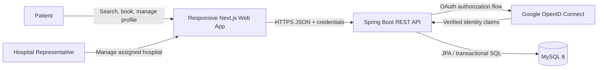
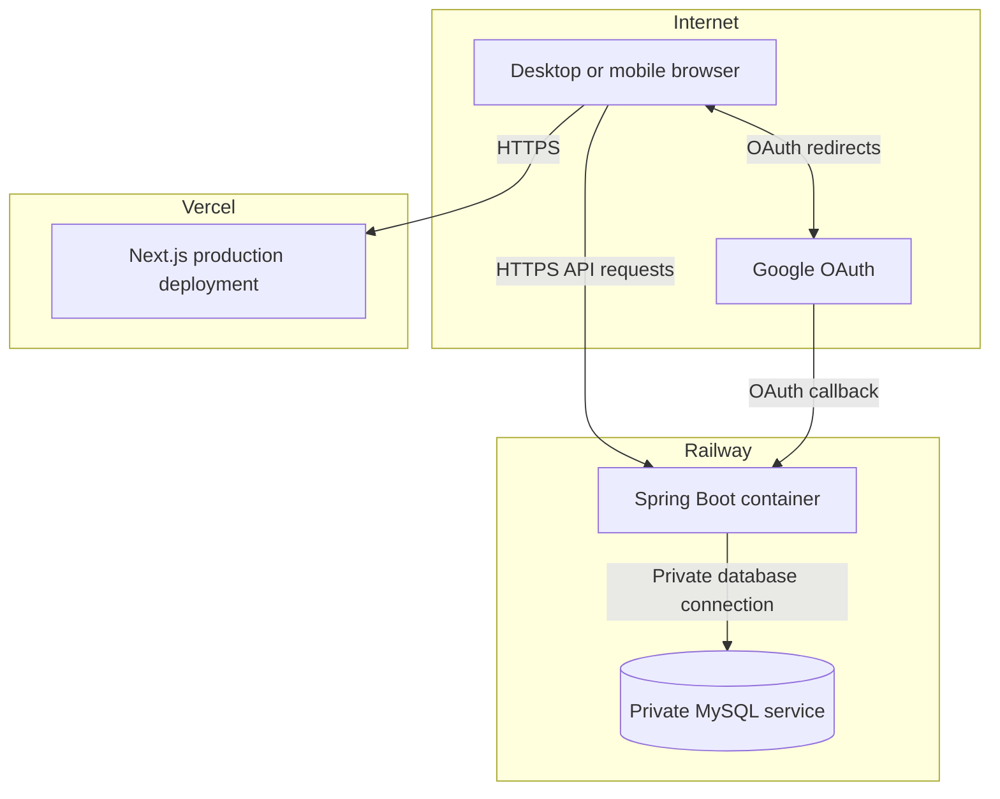
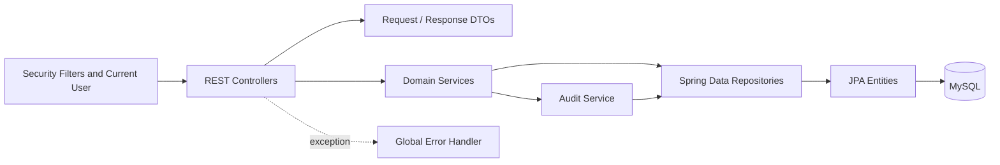
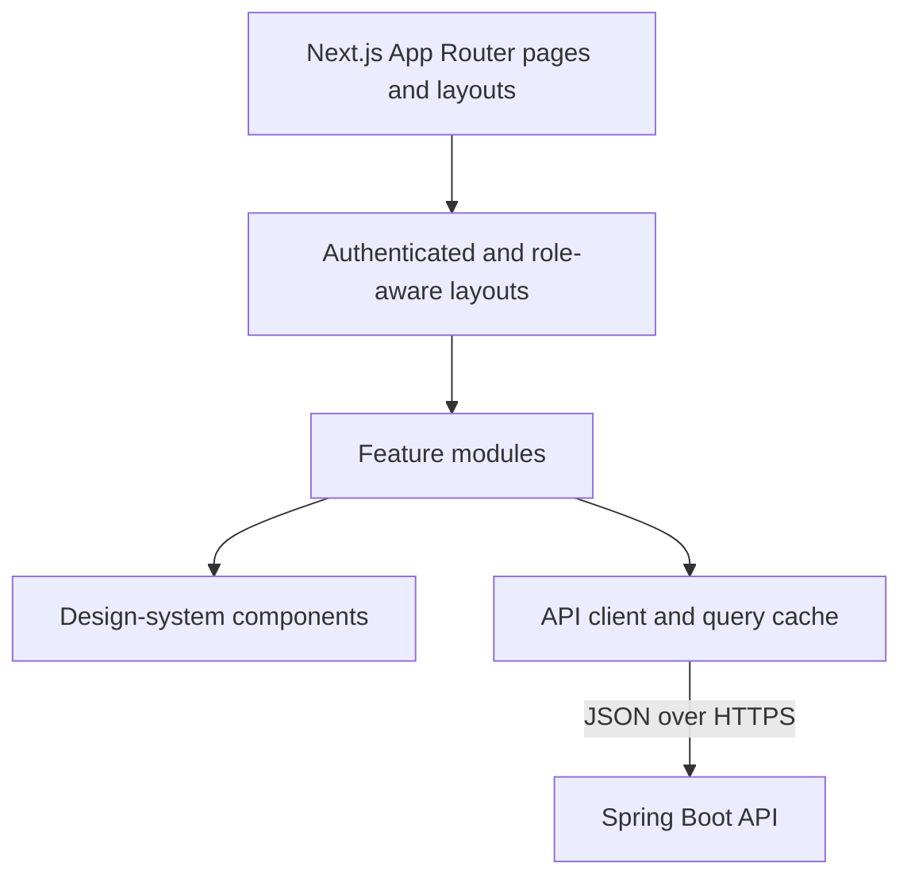
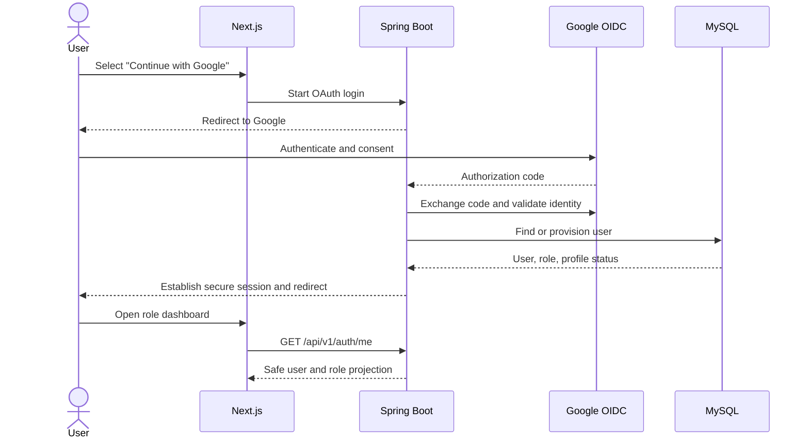
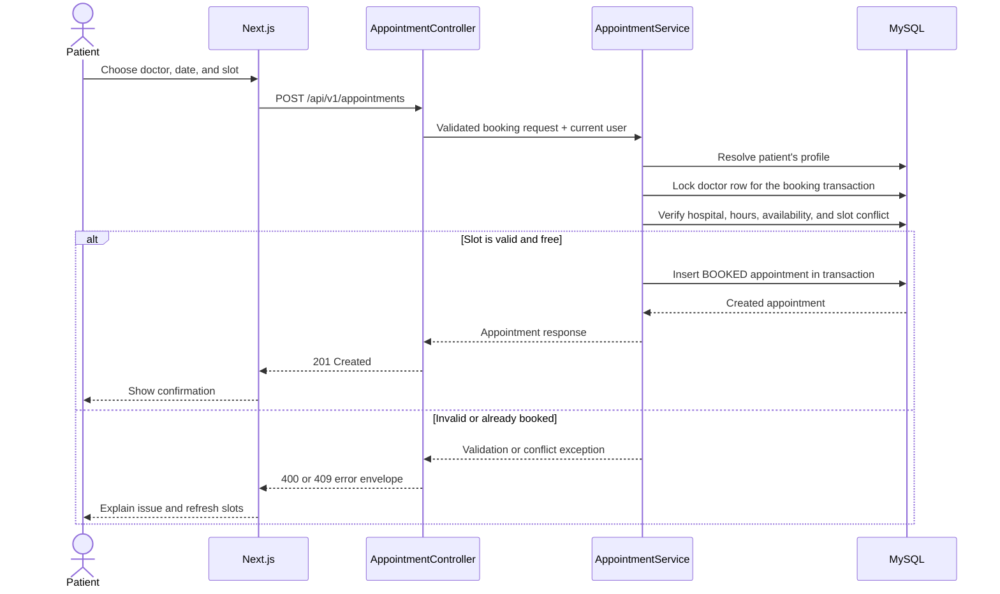
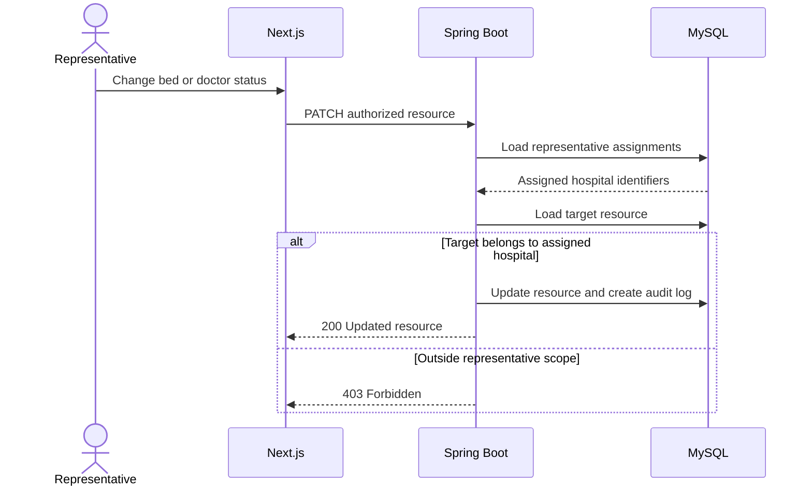

# System Architecture

## 1. Purpose

VitaNova Connect modernizes the legacy Medical Aid Tracker into a deployment-ready
full-stack application for two roles:

- **Patient** — discovers hospitals, doctors, beds, and ambulances; manages a
  personal profile; books and cancels appointments; and requests an ambulance.
- **Representative** — manages operational data only for assigned hospitals,
  including doctor availability, bed status, and appointment cancellation.

The design is a **modular monolith**. It deliberately uses one frontend, one
backend, and one relational database. This provides clear separation of concerns
without introducing microservices, queues, service discovery, or other
infrastructure that would not add educational or product value at this scale.

## 2. Architectural goals

- Preserve the useful domain rules and seed data from the JDBC application.
- Make authentication, authorization, validation, and auditing server-owned.
- Expose predictable, versioned REST APIs.
- Keep the frontend responsive, accessible, and independently deployable.
- Make database changes reproducible through migrations.
- Support local development and cloud deployment through environment variables.
- Make important engineering decisions easy to explain in a final-year viva.

### Non-goals

- Clinical diagnosis, treatment advice, or electronic health record management.
- Real-time GPS dispatch or integration with emergency telephone systems.
- Insurance, billing, payment, or prescription processing.
- A self-service administrator portal.
- Microservices or multi-region high-availability infrastructure.

## 3. Technology decisions

| Concern | Technology | Rationale |
|---|---|---|
| Web client | Next.js 16 with TypeScript | Modern routing, good developer experience, strong type safety, and direct Vercel support. |
| UI | Tailwind CSS and reusable accessible components | A consistent design system without a large custom CSS framework. |
| Server-state client | TanStack Query where remote caching is useful | Standard loading, error, cache invalidation, and retry behavior. |
| Backend | Java 21 and Spring Boot 3.5 | Retains Java while adding mature REST, validation, security, and configuration support. |
| Security | Spring Security and Google OAuth 2.0 / OpenID Connect | Delegates identity proof to Google while keeping application roles in the database. |
| Persistence | Spring Data JPA / Hibernate | Replaces unmanaged JDBC resources with repositories and transaction-aware persistence. |
| Database | MySQL 8 | Preserves the relational DBMS focus and supports the existing dataset. |
| Schema management | Flyway | Makes every database change ordered, repeatable, and reviewable. |
| API contract | OpenAPI / Swagger UI | Provides interactive documentation for development and viva demonstration. |
| Logging | SLF4J with Logback | Structured application logging using the Spring ecosystem defaults. |
| Deployment | Vercel, Railway, and Railway MySQL | A simple three-part deployment that matches the application boundaries. |

## 4. System context

The browser renders the user experience, but it is not a security boundary. All
permissions are checked again by Spring Security and the relevant service before
data is read or changed.

## 5. Deployment architecture

Only the backend connects to MySQL. The browser never receives database
credentials. The backend permits only configured frontend origins, and production
cookies use secure attributes appropriate to the final domain arrangement.

## 6. Backend component model

### Layer responsibilities

- **Controller** — HTTP concerns only: route, status code, request validation, and
  conversion to/from DTOs.
- **Service** — business rules, ownership checks, representative scope checks,
  transactions, and audit decisions.
- **Repository** — persistence queries and indexes; it does not contain UI or
  authorization policy.
- **Entity** — relational mapping and local invariants.
- **Security** — identity resolution, role enforcement, CSRF/CORS/session policy,
  and current-user access.
- **Global error handler** — converts known failures into a consistent safe error
  envelope while preserving detailed server-side logs.

## 7. Frontend component model

The frontend may hide navigation that a role cannot use, but this is usability
only. Backend authorization remains authoritative.

## 8. Request lifecycle

1. The browser sends a request to `/api/v1/...` with the authenticated credential.
2. Spring Security resolves the authenticated `User`.
3. Route-level policy checks the required role.
4. Jakarta Validation checks the incoming DTO.
5. The service derives patient identity from the current user or verifies the
   representative's hospital assignment.
6. Repository operations execute inside a transaction when the action spans
   multiple checks or writes.
7. A response DTO is returned; entities and internal identity-provider fields are
   never serialized directly.
8. Expected failures are mapped to a stable Problem Details response; unexpected
   failures are logged without exposing details to the client.

## 9. Authentication sequence

Patient identities may be provisioned on first sign-in and then complete their
profile. Representative privileges are never selected by the user; they are
granted only when the Google email/subject matches a pre-authorized representative
record.

## 10. Appointment booking sequence

The service takes a pessimistic lock on the doctor row before its final conflict
query and insert. Competing bookings for that doctor are therefore serialized
until the transaction completes. The earlier availability query improves the
user experience but is not sufficient by itself.

## 11. Representative update sequence

## 12. Business invariants

- A user has one application role at a time: `PATIENT` or `REPRESENTATIVE`.
- A patient can read and cancel only appointments associated with their own
  profile.
- A representative can manage only resources belonging to an assigned hospital.
- A doctor belongs to one hospital in the current project scope.
- Every ambulance belongs to one hospital after Flyway migration `V3`.
- Appointment hospital and doctor hospital must match.
- Appointment start time must be in the future, within the doctor's working
  hours, and must not overlap another active appointment for that doctor.
- Booking locks the doctor row, rechecks conflicts, and inserts inside one
  transaction so concurrent requests cannot both claim the same slot.
- Cancellation changes status and records a reason/time; it does not delete the
  historical row.
- An elapsed stored `BOOKED` appointment is exposed and filtered as effectively
  `COMPLETED`; no background scheduler is required to rewrite the row.
- Patient and representative appointment lists accept `startsAfter` as an exact
  lower time bound; representative results remain hospital-scoped.
- Ambulance requests currently provide intake and patient-owned history only;
  dispatch, assignment, and status transitions are outside the implemented API.
- Bed and doctor operational changes are audited.
- OAuth identity, role, and representative assignment cannot be changed through
  the patient profile API.

## 13. Transaction boundaries

Transactions are used for operations whose correctness depends on multiple steps:

- appointment validation plus insertion;
- cancellation plus audit record;
- ambulance request creation plus ambulance status assignment, if assignment is
  performed synchronously;
- representative status change plus audit record;
- controlled account suspension and dependent state changes.

Read-only searches use repository projections and pagination. Long-running
network calls, including OAuth provider communication, are not performed inside
database transactions.

## 14. Error and failure behavior

| Failure | Expected behavior |
|---|---|
| Invalid input | `400 Bad Request` with field-safe validation details. |
| Missing/expired authentication | `401 Unauthorized`; the frontend offers sign-in. |
| Wrong role or hospital scope | `403 Forbidden`; no target details are leaked. |
| Missing resource | `404 Not Found`. |
| Concurrent slot booking | `409 Conflict`; frontend refreshes available slots. |
| Database or unexpected error | `500 Internal Server Error` with safe Problem Details; diagnostics remain in server logs. |
| OAuth provider unavailable | Login fails safely and can be retried; no partial elevated account is created. |

## 15. Time and data conventions

- API timestamps use ISO 8601.
- Persistent timestamps are stored consistently in UTC.
- The UI formats timestamps for the configured user/application timezone.
- Appointment slot calculations use one documented application timezone until
  hospitals in multiple timezones are supported.
- Phone numbers are strings, not numeric values.
- Database identifiers are opaque to clients.

## 16. Legacy-to-modern mapping

| Legacy concern | Modern destination |
|---|---|
| Console/JavaFX screens | Next.js routes and reusable feature components |
| Static JDBC methods | Transactional services and Spring Data repositories |
| Menu role selection | Google identity plus database-owned role |
| Hard-coded database credentials | Environment variables |
| Returned `ResultSet` objects | Typed response DTOs |
| Appointment deletion | Status-based cancellation with audit history |
| `patients` without identity | `users` plus `patient_profiles` |
| Missing ambulance request table | Explicit `ambulance_requests` lifecycle |
| Multiple inconsistent table names | One Flyway-managed schema |

## 17. Architecture decision summary

The architecture demonstrates the final-year project's core engineering themes:
relational modeling, transactions, REST design, OAuth identity, role-based access
control, responsive frontend development, testing, migrations, containerized
deployment, and documentation. It remains small enough for a student team to
understand, run locally, demonstrate, and maintain.
