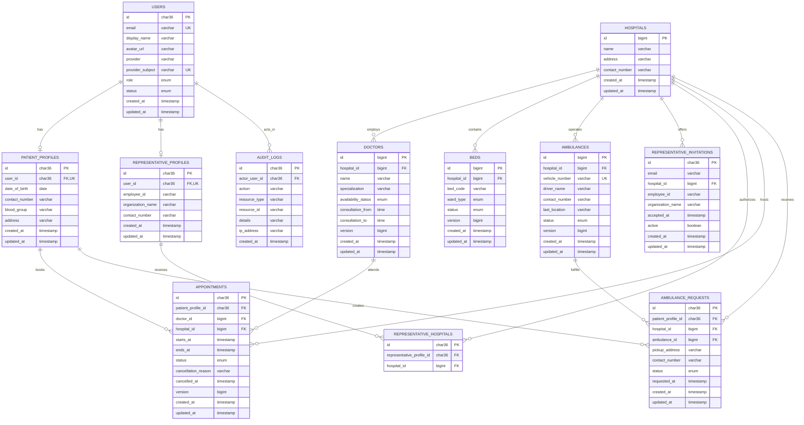

# Database Schema

## 1. Scope and source of truth

The modern application uses MySQL 8. The ordered Flyway migrations under the
backend resources are the executable source of truth; this document explains the
intended model and constraints.

The legacy dump is retained for historical comparison and seed-data migration.
It is not applied directly to production because its names, foreign keys, and
implemented Java queries are inconsistent with one another.

## 2. Entity-relationship diagram

The schema uses UUID values stored as `CHAR(36)` for identities, assignments, and
history records, and auto-increment `BIGINT` values for hospital reference and
operational inventory data. API consumers must treat both as opaque.

## 3. Table definitions

### `users`

Stores application identity and authorization metadata.

| Column | Required | Notes |
|---|---:|---|
| `id` | Yes | UUID stored as `CHAR(36)` primary key. |
| `email` | Yes | Normalized email; unique. |
| `display_name` | Yes | Name received from Google and editable only where policy permits. |
| `avatar_url` | No | Google profile image URL used only for presentation. |
| `provider` | Yes | Authentication provider, initially `GOOGLE`. |
| `provider_subject` | Yes | Stable OpenID Connect subject; unique. |
| `role` | Yes | `PATIENT` or `REPRESENTATIVE`; server-owned. |
| `status` | Yes | `ACTIVE` or `SUSPENDED`. |
| `created_at`, `updated_at` | Yes | Audit timestamps. |

The provider subject, not an email address alone, is the durable link to Google.
Email remains unique for application usability. Representative provisioning must
verify both the configured account and provider claims before granting access.

### `patient_profiles`

Contains patient-specific personal data without mixing it into the authentication
record.

| Column | Required | Notes |
|---|---:|---|
| `id` | Yes | UUID stored as `CHAR(36)` primary key. |
| `user_id` | Yes | Unique foreign key to `users`. |
| `date_of_birth` | After onboarding | Must be in the past. |
| `contact_number` | After onboarding | Validated as text; formatting may include a country code. |
| `blood_group` | After onboarding | One of `A+`, `A-`, `B+`, `B-`, `AB+`, `AB-`, `O+`, or `O-`. |
| `address` | No | Optional patient address, limited to 500 characters. |
| timestamps | Yes | Created and last-updated time. |

Profile completion is derived from date of birth, contact number, and blood group;
it is not persisted as a separate flag that could drift from those fields.

### `representative_profiles`

Stores representative metadata. A representative account is provisioned through
a controlled operational process; there is no public representative registration.

| Column | Required | Notes |
|---|---:|---|
| `id` | Yes | UUID stored as `CHAR(36)` primary key. |
| `user_id` | Yes | Unique foreign key to `users`. |
| `employee_id` | No | Organization-specific reference. |
| `organization_name` | No | Display/audit context. |
| `contact_number` | No | Representative contact number. |
| timestamps | Yes | Created and last-updated time. |

### `representative_invitations`

Stores controlled representative email-to-hospital allowlist entries. There is no
public invitation-management API in the current scope.

| Column | Required | Notes |
|---|---:|---|
| `id` | Yes | UUID stored as `CHAR(36)` primary key. |
| `email` | Yes | Normalized intended Google account. |
| `hospital_id` | Yes | Hospital granted when this invitation is accepted. |
| `employee_id` | No | Metadata copied into a new representative profile. |
| `organization_name` | No | Metadata copied into a new representative profile. |
| `accepted_at` | After acceptance | Acceptance timestamp. |
| `active` | Yes | Only active invitations participate in sign-in provisioning. |
| timestamps | Yes | Created and last-updated time. |

Hospital assignments are still represented explicitly in
`representative_hospitals`. An invitation never implies access to every hospital.
The database uniquely constrains `(email, hospital_id)`, and successful
provisioning marks the matching row inactive.

### `hospitals`

Stores institutions searchable by patients and manageable through representative
assignments.

| Column | Required | Notes |
|---|---:|---|
| `id` | Yes | Auto-increment `BIGINT` primary key. |
| `name` | Yes | Indexed for search. |
| `address` | Yes | Human-readable address. |
| `contact_number` | Yes | Hospital contact details. |
| timestamps | Yes | Created and last-updated time. |

### `representative_hospitals`

Many-to-many authorization join table. Its unique pair prevents a duplicate
assignment. It is both domain data and an authorization boundary.

| Column | Required | Notes |
|---|---:|---|
| `id` | Yes | UUID stored as `CHAR(36)` primary key. |
| `representative_profile_id` | Yes | Foreign key to `representative_profiles`. |
| `hospital_id` | Yes | Foreign key to `hospitals`. |

### `doctors`

| Column | Required | Notes |
|---|---:|---|
| `id` | Yes | Auto-increment `BIGINT` primary key. |
| `hospital_id` | Yes | Doctor's hospital in the current scope. |
| `name` | Yes | Display/search name. |
| `specialization` | Yes | Indexed search value. |
| `availability_status` | Yes | `AVAILABLE` or `UNAVAILABLE`. |
| `consultation_from`, `consultation_to` | Yes | Working-hours window; end must be after start. |
| `version` | Yes | Optimistic-lock version for operational updates. |
| timestamps | Yes | Created and last-updated time. |

### `beds`

Each row represents an individual bed so that status changes can be traced and
availability can be aggregated.

| Column | Required | Notes |
|---|---:|---|
| `id` | Yes | Auto-increment `BIGINT` primary key. |
| `hospital_id` | Yes | Owning hospital. |
| `bed_code` | Yes | Unique within a hospital. |
| `ward_type` | Yes | `ICU` or `GENERAL`. |
| `status` | Yes | `AVAILABLE`, `OCCUPIED`, or optionally `MAINTENANCE`. |
| `version` | Yes | Optimistic-lock version for representative updates. |
| timestamps | Yes | Created and last-updated time. |

### `appointments`

Appointments are retained throughout their lifecycle. Cancellation is a state
transition, not a deletion.

| Column | Required | Notes |
|---|---:|---|
| `id` | Yes | UUID stored as `CHAR(36)` and exposed only as an opaque reference. |
| `patient_profile_id` | Yes | Booking patient. |
| `doctor_id` | Yes | Selected doctor. |
| `hospital_id` | Yes | Must equal the doctor's hospital at booking time. |
| `starts_at`, `ends_at` | Yes | Time range; end must follow start. |
| `status` | Yes | `BOOKED`, `COMPLETED`, or `CANCELLED`. |
| `cancellation_reason` | On cancellation | User-safe reason; length limited. |
| `cancelled_at` | On cancellation | State-transition timestamp. |
| `version` | Yes | Optimistic-lock version for lifecycle updates. |
| timestamps | Yes | Created and last-updated time. |

If fixed one-hour slots are used, `ends_at` is derived by the backend rather than
trusted from the client.

The stored status is intentionally not rewritten by a scheduler when time passes.
At query/DTO mapping time, an elapsed `BOOKED` appointment is treated as
effectively `COMPLETED`; `BOOKED` filters exclude it and `COMPLETED` filters
include it. The underlying row remains an immutable record of the booking unless
an explicit supported lifecycle transition occurs.

### `ambulances`

| Column | Required | Notes |
|---|---:|---|
| `id` | Yes | Auto-increment `BIGINT` primary key. |
| `hospital_id` | Yes | Operating hospital; every requestable ambulance belongs to one hospital. |
| `vehicle_number` | Yes | Unique normalized vehicle identifier. |
| `driver_name` | Yes | Operational contact. |
| `contact_number` | Yes | Stored as text. |
| `last_location` | Yes | Human-readable location; not real-time GPS. |
| `status` | Yes | `AVAILABLE`, `UNAVAILABLE`, or `ON_DUTY`. |
| `version` | Yes | Optimistic-lock version for operational updates. |
| timestamps | Yes | Created and last-updated time. |

### `ambulance_requests`

| Column | Required | Notes |
|---|---:|---|
| `id` | Yes | UUID stored as `CHAR(36)` primary key. |
| `patient_profile_id` | Yes | Requesting patient. |
| `hospital_id` | Yes | Requested hospital. |
| `ambulance_id` | No | Assigned ambulance, if any. |
| `pickup_address` | Yes | Validated and limited to 500 characters. |
| `contact_number` | Yes | Contact for the request. |
| `status` | Yes | `PENDING`, `ASSIGNED`, `COMPLETED`, or `CANCELLED`. |
| `requested_at` | Yes | Creation time. |
| timestamps | Yes | Created and last-updated time. |

The current API creates `PENDING` requests and lists the authenticated patient's
history. `ASSIGNED`, `COMPLETED`, `CANCELLED`, and `ambulance_id` support a future
controlled dispatch workflow; no current public or representative endpoint
performs those transitions.

### `audit_logs`

Records security- and operation-relevant actions. Audit rows are append-only from
the application perspective.

| Column | Required | Notes |
|---|---:|---|
| `id` | Yes | UUID stored as `CHAR(36)` primary key. |
| `actor_user_id` | No | Authenticated actor when available. |
| `action` | Yes | Stable action name, such as `BED_STATUS_UPDATED`. |
| `resource_type`, `resource_id` | Yes | Target reference without a polymorphic foreign key. |
| `details` | No | Minimal safe description, limited to 2,000 characters. |
| `ip_address` | No | Request IP when supplied by the audit integration. |
| `created_at` | Yes | Immutable event time. |

### Spring Session tables

Spring Session JDBC owns two infrastructure tables rather than storing session
state in backend process memory:

- `SPRING_SESSION` — primary/session IDs, creation time, last access time, maximum
  inactive interval, expiry time, and optional principal name.
- `SPRING_SESSION_ATTRIBUTES` — serialized session attributes keyed by session
  primary ID and attribute name.

These tables are infrastructure, not domain entities, and are not exposed through
the REST API. The attributes table references the session table and is cleaned up
with its parent session. Indexes on session ID, expiry time, and principal name
support request lookup and expiry cleanup.

## 4. Relationship and deletion policy

| Parent → child | Cardinality | Deletion behavior |
|---|---|---|
| `users` → patient/representative profile | One to zero-or-one | Account is normally suspended, not hard-deleted. |
| `hospitals` → representative invitations | One to many | Accepted rows remain as inactive provisioning evidence. |
| `representative_profiles` ↔ `hospitals` | Many to many | Removing an assignment removes only the join row. |
| `hospitals` → doctors/beds/ambulances | One to many | Foreign keys restrict unsafe deletion while history refers to the hospital. |
| patient/doctor/hospital → appointments | One to many | Historical appointments are retained; foreign keys restrict unsafe deletion. |
| patient/hospital/ambulance → ambulance requests | One to many | Request history is retained; ambulance assignment may be nullable. |
| `users` → audit logs | One to many | Audit history is retained according to policy. |

The schema avoids the legacy `ON DELETE CASCADE` behavior for historical
appointments. Destructive cascades make auditing and representative accountability
unreliable.

## 5. Constraints and invariants

- Unique normalized user email.
- Unique provider subject identity.
- Unique profile `user_id`.
- Unique `(representative_profile_id, hospital_id)` assignment.
- Unique `(hospital_id, bed_code)`.
- Unique ambulance vehicle number.
- Doctor consultation end is expected after consultation start; hours come from
  controlled reference data in the current API scope.
- Appointment end is derived by the booking service from the configured duration,
  so it follows the start.
- Appointment hospital is derived from the locked doctor inside the booking
  transaction.
- Only active, non-cancelled appointments participate in slot-conflict checks.
- State-transition fields are consistent: for example, a cancelled appointment
  has both a cancellation timestamp and an allowed previous state.

### Preventing double booking

The appointment service starts a transaction, obtains a pessimistic lock on the
selected doctor row, then checks for an overlapping active appointment and
inserts only if no conflict exists. All competing booking transactions for that
doctor pass through the same lock. This works for arbitrary time-range overlap;
a simple unique key on start time would detect identical starts but not every
overlap.

## 6. Index plan

Indexes support actual user flows rather than indexing every field.

| Index | Supports |
|---|---|
| `users(email)` unique | Login provisioning and lookup. |
| `users(provider_subject)` unique | Durable OAuth identity lookup. |
| `representative_invitations(email, hospital_id)` unique | Prevent duplicate allowlist entry for one hospital. |
| `doctors(specialization)` | Patient doctor filters. |
| `doctors(hospital_id, availability_status)` | Hospital detail and emergency search. |
| `beds(hospital_id, ward_type, status)` | Available-bed counts. |
| `appointments(patient_profile_id, starts_at)` | Patient appointment timeline. |
| `appointments(doctor_id, starts_at, status)` | Slot lookup and conflict checks. |
| `appointments(hospital_id, starts_at)` | Representative operational list. |
| `ambulances(status)` | Available ambulance search. |
| `ambulance_requests(patient_profile_id, requested_at)` | Patient request history. |
| `representative_hospitals(representative_profile_id, hospital_id)` unique | Authorization scope lookup and duplicate prevention. |
| `audit_logs(resource_type, resource_id, created_at)` | Resource audit trail. |
| `SPRING_SESSION(SESSION_ID)` unique | Cookie-to-session lookup. |
| `SPRING_SESSION(EXPIRY_TIME)` | Expired-session cleanup. |
| `SPRING_SESSION(PRINCIPAL_NAME)` | Principal session lookup/invalidation. |

Index effectiveness should be checked using `EXPLAIN` with representative data
before adding more indexes. Every additional index increases write cost.

## 7. Migration strategy

Flyway migrations are append-only after they reach a shared environment. The
initial implementation contains:

1. `V1__create_core_schema.sql` — creates domain tables, constraints, indexes, and
   Spring Session tables.
2. `V2__seed_reference_data.sql` — inserts sanitized/reference hospitals,
   doctors, beds, ambulances, and controlled demonstration provisioning data.
3. `V3__require_ambulance_hospital.sql` — makes `ambulances.hospital_id`
   non-null after all seeded ambulances have an owning hospital.

Future changes start with `V4`; an already-applied migration is never silently
rewritten.

Exact migration names and types in the backend remain authoritative.

### Migration rules

- Never edit an already-applied production migration.
- Add a new forward migration for every schema change.
- Back up production data before a destructive migration.
- Separate schema migrations from large or environment-specific seed data.
- Run migrations with a database principal that has only the permissions needed
  for migration; the runtime principal may be more restricted when practical.

## 8. Legacy data mapping

| Legacy table/field | New destination | Transformation |
|---|---|---|
| `patients` | `users` + `patient_profiles` | Create an application identity only when a verified email mapping exists; otherwise load as non-login demo data or sanitize. |
| `hospitals` | `hospitals` | Preserve valid name/address/contact data and add lifecycle timestamps. |
| `doctors` | `doctors` | Normalize status casing and preserve working hours. |
| `bed_availability` | `beds` | Generate stable bed codes and normalize `General` to `GENERAL`. |
| `appointments` | `appointments` | Convert separate date/time to timestamp range and validate historical anomalies. |
| `ambulance_services` | `ambulances` | Assign an owning hospital where known and normalize statuses/vehicle identity. |
| nonexistent `ambulance_requests` | `ambulance_requests` | Create as a new table; no legacy request history is fabricated. |

The legacy dump contains anomalous dates and orphan-prone concepts. Migration must
produce a validation report rather than silently treating every row as production
truth.

## 9. Data privacy and retention

- Store only fields required for the demonstrated workflows.
- Do not store Google access tokens unless a concrete API integration needs them.
- Never log OAuth credentials, session identifiers, database passwords, or full
  profile payloads.
- Prefer account suspension and controlled retention to ad hoc row deletion.
- Keep audit detail strings minimal and redact sensitive fields.
- Use synthetic or explicitly sanitized seed data in public repositories and viva
  demonstrations.
- Document backup retention and deletion procedures for the deployed environment.

## 10. DBMS concepts demonstrated

The schema intentionally exposes final-year DBMS learning outcomes:

- normalization of identity and role profiles;
- primary, foreign, unique, and composite keys;
- one-to-one, one-to-many, and many-to-many relationships;
- referential integrity and safe deletion policy;
- transactions and concurrency control;
- indexed search and query-plan analysis;
- controlled status domains;
- schema versioning and data migration;
- aggregate availability queries and relational joins.
