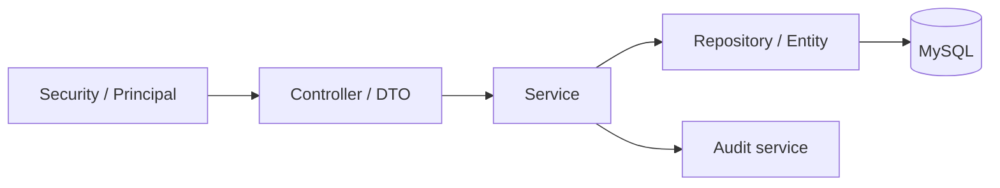

# Module Guide

## 1. Repository boundaries

```text
medical-aid-tracker/
├── frontend/              Next.js and TypeScript web client
├── backend/               Java and Spring Boot REST application
├── docs/                  Architecture, API, operations, and viva material
├── legacy/                Original JDBC, JavaFX, SQL, and ER artifacts
├── compose.yaml           Local frontend, backend, and MySQL services
├── Makefile               Short local build/run/test commands
├── .env.example           Non-secret configuration reference, when provided
└── README.md              Project entry point
```

`legacy/` is read-only historical material for the modern runtime. New
application code must not depend on legacy classes or execute the legacy SQL dump.

## 2. Frontend modules

The frontend is organized by route and feature, with reusable presentation
components kept separate from API-specific behavior.

```text
frontend/
├── app/
│   ├── (public)/
│   │   └── page.tsx
│   ├── login/
│   │   └── page.tsx
│   ├── auth/callback/
│   │   └── page.tsx
│   ├── patient/
│   │   ├── layout.tsx
│   │   ├── dashboard/page.tsx
│   │   ├── onboarding/page.tsx
│   │   ├── doctors/page.tsx
│   │   ├── doctors/[id]/page.tsx
│   │   ├── emergency/page.tsx
│   │   ├── appointments/page.tsx
│   │   ├── ambulances/page.tsx
│   │   └── profile/page.tsx
│   └── representative/
│       ├── layout.tsx
│       ├── dashboard/page.tsx
│       ├── doctors/page.tsx
│       ├── beds/page.tsx
│       ├── appointments/page.tsx
│       └── profile/page.tsx
├── components/
│   ├── ui/
│   ├── portal-shell.tsx
│   ├── providers.tsx
│   └── reusable page/brand/status components
├── features/
│   ├── auth/
│   ├── profile/
│   ├── doctors/
│   ├── appointments/
│   ├── ambulances/
│   └── representative/
├── lib/
│   ├── api.ts
│   ├── query-keys.ts
│   ├── utils.ts
│   └── focused unit tests
├── types/api.ts
├── public/
└── proxy.ts
```

This is the implemented organization; individual feature directories contain
only the components/hooks they currently need.

### Route modules

| Module | Responsibility |
|---|---|
| Public | Landing page, product explanation, and sign-in entry point. |
| Login | Starts backend Google OAuth and renders safe login errors. |
| Patient layout | Patient navigation, responsive shell, and patient role gate. |
| Patient dashboard | Upcoming appointment and discovery shortcuts. |
| Doctor discovery | Filters, doctor cards/table, availability, and slot selection. |
| Appointments | Booking confirmation, list, status, and cancellation. |
| Ambulances | Available services and request workflow. |
| Profile | Onboarding and editable patient fields. |
| Representative layout | Representative navigation and role gate. |
| Representative dashboard | Assigned-hospital operational summaries. |
| Doctor operations | Scoped availability management. |
| Bed operations | Scoped ward/status filtering and updates. |
| Appointment operations | Scoped appointment view and cancellation. |

### Shared frontend responsibilities

- `components/ui` contains style-system primitives with no domain API calls.
- root-level `components` contain the portal shell, page framing, providers,
  reusable notices, and status/stat presentation.
- `features/*` contains domain components, forms, query hooks, and mapping logic.
- `lib/api.ts` centralizes the API base URL, credential inclusion, JSON parsing, and
  conversion of error envelopes.
- `types/api.ts` contains public client-side contract types; it must not duplicate
  backend persistence entities.

### Frontend state policy

- URL state: filters, page, and sort values that should survive refresh/share.
- Server state: TanStack Query over the centralized API client, with explicit
  loading/error behavior.
- Local component state: open dialogs and temporary form interaction.
- Authentication state: always refreshed from `/api/v1/auth/me`; role data in
  browser storage is not authoritative.

Global state management is not introduced until a demonstrated cross-page need
exists.

## 3. Backend modules

The backend is a package-by-feature modular monolith.

```text
backend/src/main/java/<base-package>/
├── MedicalAidTrackerApplication.java
├── config/
├── security/
├── user/
├── representative/
├── hospital/
├── doctor/
├── bed/
├── appointment/
├── ambulance/
├── audit/
└── common/
    ├── api/
    ├── domain/
    └── exception/
```

Each domain package may contain controller, service, repository, entity, DTO, and
mapper classes as needed. Small modules do not need placeholder abstraction
layers.

### `config`

- environment-backed application properties;
- CORS, cookie, timezone, Jackson, and OpenAPI configuration;
- production-safe defaults and profile-specific behavior.

### `security`

- Spring Security filter chain;
- Google OAuth/OIDC success and failure handling;
- user provisioning and representative invitation/allowlist resolution;
- database-backed session integration;
- current-user principal projection and logout.

Authentication proves identity. Role lookup and representative hospital
assignment provide authorization.

### `user`

- `User` persistence and status;
- safe current-user projection;
- shared identity lookup;
- account lifecycle rules.
- patient and representative profile persistence;
- patient onboarding/profile validation;
- current-user-to-profile resolution and patient ownership policy.

### `representative`

- representative profile;
- hospital assignment and invitation/provisioning metadata;
- scoped dashboard aggregation;
- reusable "representative may manage hospital" authorization checks.

### `hospital`

- hospital discovery and detail;
- emergency availability aggregation;
- hospital data projections used by patient and representative features.

### `doctor`

- doctor search and details;
- working hours and availability;
- representative-scoped status changes;
- available-slot input to appointment logic.

### `bed`

- individual bed state;
- hospital/ward availability aggregates;
- representative-scoped changes and audit.

### `appointment`

- patient appointment timeline;
- slot generation;
- booking validation and transaction;
- ownership-aware patient cancellation;
- hospital-scoped representative cancellation;
- lifecycle status.

### `ambulance`

- ambulance discovery;
- patient-owned request intake and history;
- `PENDING` request creation with no dispatch guarantee;
- ownership checks on request history;
- future-ready assignment/status fields without a current transition API.

### `audit`

- append-only security/operation event creation;
- minimal safe action details;
- actor, target, action, and timestamp conventions.

### `common`

Only genuinely cross-cutting concerns belong here:

- error envelope and exception mapping;
- pagination representation;
- reusable validation primitives;
- endpoint-specific pagination sort validation.

Domain services should not be moved into `common` merely because two classes use
them.

## 4. Backend dependency rules



- Controllers depend on services, not repositories.
- Services may coordinate repositories inside a transaction.
- Repositories do not call controllers or format HTTP responses.
- Entities are not serialized directly.
- A feature may query another feature through a focused service or repository
  projection when the relationship is part of the same transaction.
- Frontend code never imports backend Java classes.

## 5. Database and migration modules

```text
backend/src/main/resources/
├── application.yml
├── application-prod.yml
└── db/migration/
    ├── V1__...
    ├── V2__...
    ├── V3__...
    └── V4__... (future)
```

Configuration files contain placeholders/defaults, not credentials. Migrations
create schema and indexes in order. `V2__seed_reference_data.sql` supplies the
current sanitized reference dataset and controlled demo representative
invitation; no real patient identity is seeded.

Spring Session tables store session identifiers and attributes in MySQL so login
survives backend process restarts and works safely with more than one backend
instance.

## 6. Cross-cutting module behavior

### Validation

- Frontend validation gives immediate feedback.
- Backend Jakarta Validation is mandatory because clients can bypass the UI.
- Services validate business invariants that require database state.
- Database constraints provide the final integrity boundary.

### Errors

- Domain failures have stable error codes.
- One global handler converts them into the API error envelope.
- Unexpected exceptions are logged server-side with stack traces where useful.
- Responses never include stack traces or database details.

### Logging

Recommended event categories:

- authentication success/failure without tokens;
- authorization denial without sensitive target details;
- important state transitions;
- unexpected failures with method and request path;
- startup configuration summary with secrets redacted.

### Mapping

DTO mapping is explicit. A mapping library is optional; for a project of this
size, small hand-written mappings are often clearer in a viva than an additional
compile-time framework.

## 7. Legacy module assessment

| Legacy artifact | Value retained | Runtime status |
|---|---|---|
| `med_aid_track.java` | Search, booking, and representative use cases | Replaced |
| `MedicalAidTracker.java` | JDBC query intent | Replaced |
| `CityHospitalManagementLogin.java` | Early UI workflow prototype | Replaced |
| `data.sql` | Hospital/doctor/bed/ambulance seed source | Sanitized and migrated |
| ER diagrams | Design history | Superseded by current schema documentation |

The legacy artifacts are useful evidence of iterative development during a viva.
They should not be compiled with the modern backend.

## 8. Simplicity controls

The following are intentionally absent until a measured need appears:

- microservices and message brokers;
- generic repository wrappers over Spring Data;
- multiple authentication providers;
- custom design-system package publication;
- GraphQL in addition to REST;
- Kubernetes;
- distributed tracing infrastructure;
- complex event sourcing.

These omissions are architectural decisions, not missing engineering. The
project demonstrates strong boundaries and operational readiness at an
appropriate scale.
