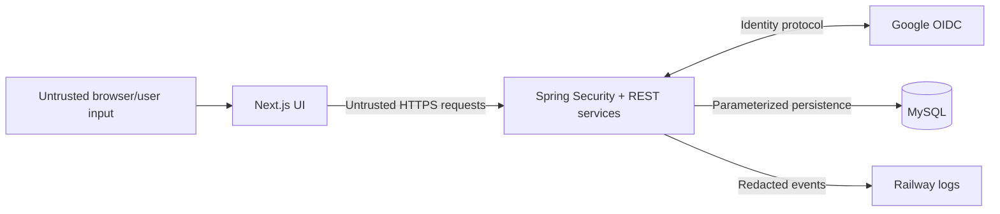

# Security Design

## 1. Security objectives

The application handles identity, contact details, date of birth, appointment
metadata, and hospital operations. Its primary security goals are:

- authenticate each user through a trusted OpenID Connect provider;
- prevent patient-to-patient and cross-hospital data access;
- prevent self-assignment of representative privileges;
- protect sessions and state-changing requests;
- validate all untrusted input;
- protect credentials and personal data from logs/repositories;
- retain an audit trail for important representative actions;
- fail safely without revealing internal details.

This is an educational medical-services application, not a certified clinical
system. Deployment owners must not claim regulatory compliance without a
separate legal, operational, and security assessment.

## 2. Trust boundaries

The frontend is not trusted for role, ownership, field validity, or resource
scope. The backend is the policy-enforcement point. MySQL transactions, locking,
and constraints remain the final integrity boundary for concurrent writes.

## 3. Protected assets

| Asset | Main risks |
|---|---|
| Patient profile | Unauthorized disclosure, enumeration, over-collection. |
| Appointment/request history | Cross-user access, destructive deletion, inference. |
| Representative role and assignments | Privilege escalation, excessive scope. |
| Bed/doctor operational state | Unauthorized or misleading updates. |
| OAuth client secret | Provider impersonation/abuse. |
| Session ID | Account/session hijacking. |
| Database credentials | Full data compromise. |
| Audit trail | Tampering, secret/personal-data leakage. |

## 4. Authentication

### Google OpenID Connect

- Spring Security performs the authorization-code flow.
- The backend validates provider response, issuer, audience, nonce/state, and
  identity claims through the framework/provider configuration.
- Minimal scopes are requested: `openid`, `profile`, and `email`.
- The stable provider subject is stored; email alone is not treated as an
  immutable identity key.
- Google client secret remains backend-only.
- OAuth authorization codes and tokens are never sent through the frontend URL or
  stored in browser local storage by application code.

### Provisioning

- A new eligible sign-in defaults to `PATIENT`.
- A patient cannot request or patch the representative role.
- Representative role requires a valid pre-authorized invitation/allowlist record
  matched to the intended Google identity.
- Active representative allowlist rows are consumed by successful provisioning and
  marked inactive.
- Hospital assignments are explicit and have no wildcard default.
- Inactive users cannot establish a usable application session.

There is no public administrator endpoint in the project scope. Representative
provisioning is a controlled operational/database procedure and must be audited.

## 5. Authorization

Authorization has three layers:

1. route/method role checks;
2. resource ownership or representative hospital-scope checks in services;
3. database query predicates/constraints that avoid loading unrelated data where
   practical.

### Patient rules

- Patient identifiers are derived from the authenticated principal.
- A patient can read/update only their own profile.
- A patient can list, create, or cancel only their own appointment/request data.
- Booking never accepts a trusted patient ID from the browser.

### Representative rules

- Every read/write is filtered by current hospital assignments.
- A representative cannot change user roles or assignments through operational
  endpoints.
- Doctor, bed, appointment, and ambulance-request targets are resolved together
  with their hospital scope.
- An out-of-scope mutation returns `403` and changes nothing.

### Insecure direct object reference defense

Opaque identifiers improve usability but do not provide authorization.
Authorization checks apply even if an attacker guesses or obtains a valid ID.

## 6. Session security

The application uses Spring Session backed by MySQL and a `JSESSIONID` cookie.

Production cookie settings:

- `HttpOnly=true`;
- `Secure=true`;
- `SameSite` set according to the verified domain topology;
- scoped path/domain no broader than required;
- appropriate idle timeout;
- server-side invalidation on logout.

The session identifier is never stored in local storage, logged, or returned in
JSON. Database-backed sessions permit controlled expiry and avoid purely
in-memory loss across process restarts.

If the frontend and backend remain on unrelated Vercel/Railway sites,
`SameSite=None; Secure` is normally necessary for credentialed fetches. Prefer
same-site custom subdomains where feasible, and test browser privacy behavior.

## 7. CSRF and CORS

These controls solve different problems:

- **CORS** controls which browser origins may read/send credentialed cross-origin
  API requests.
- **CSRF protection** verifies that a state-changing request with ambient cookies
  was intentionally made by the application.

Requirements:

- exact origin allowlist from `CORS_ALLOWED_ORIGINS`;
- credentials allowed only for those origins;
- allowed methods/headers limited to API needs;
- explicit CSRF strategy for `POST`, `PATCH`, and other mutations;
- OAuth `state`/framework protections kept enabled;
- never use a wildcard origin with credentials.

Disabling CSRF globally simply because the API returns JSON is not a complete
defense when cookie authentication is used.

## 8. Input validation

Validation is layered:

| Layer | Purpose |
|---|---|
| Frontend | Fast feedback and accessible form errors. |
| DTO/Jakarta Validation | Required fields, lengths, formats, enum domains. |
| Service | Current time, ownership, assignments, doctor/hospital consistency, state transitions. |
| Database | Foreign keys, unique rules, non-null/check constraints, concurrency integrity. |

All strings have length limits. Search, pagination, and sorting inputs are
allowlisted/bounded. The backend never trusts hidden fields or disabled controls.

## 9. SQL and persistence security

- Use Spring Data/JPA parameter binding or explicit bound parameters.
- Never concatenate raw user input into SQL/JPQL.
- Allowlist dynamic sort columns.
- Use a dedicated database user rather than MySQL root.
- Restrict the runtime database account as practical.
- Keep schema migrations reviewed and versioned.
- Use transactions for multi-step state changes.
- Serialize booking with the documented pessimistic doctor-row lock and conflict
  query in one transaction.

## 10. Secrets and configuration

Secrets include:

- database password;
- Google client secret;
- session identifiers;
- future signing/encryption keys.

Rules:

- store production values in Railway/Vercel environment configuration;
- seal sensitive Railway variables when appropriate;
- commit only `.env.example` placeholders;
- do not use `NEXT_PUBLIC_*` for secrets;
- redact secrets in startup/configuration logs;
- rotate immediately if exposed;
- do not copy production secrets into screenshots, viva slides, issue trackers, or
  chat transcripts.

The hard-coded JDBC password discovered during modernization has been removed
from the archived prototype. It must still be treated as compromised, rotated
wherever it was ever used, and never reused.

## 11. Privacy and data minimization

- Collect only profile fields required by the demonstrated workflow.
- Do not store symptoms, diagnosis, prescriptions, identity documents, or payment
  data.
- Do not store provider tokens when only sign-in identity is needed.
- Use synthetic data for development and demonstration.
- Return response DTOs containing only fields required by the current screen.
- Avoid exposing full patient profile data in representative appointment lists.
- Define account deactivation, retention, backup, and deletion processes.
- Do not use production personal data in tests.

## 12. Logging and audit

### Application logs

Safe fields:

- timestamp and severity;
- endpoint template and status;
- stable internal error code;
- user ID or a pseudonymous reference when needed;
- timing and safe operation name.

Never log:

- passwords or database URLs with credentials;
- OAuth code/token/client secret;
- `Cookie`/`Set-Cookie` values;
- complete request/response bodies;
- full date of birth/contact number;
- raw SQL containing personal values;
- stack traces in client responses.

### Domain audit

Append-only audit events cover:

- successful user/representative provisioning and invitation consumption;
- doctor availability changes;
- bed status changes;
- representative appointment cancellation;
- patient ambulance request creation;
- patient appointment booking/cancellation and profile updates;
- representative role and hospital assignment created through an invitation.

Audit detail strings contain the minimum safe changed state. Normal failed
authorization is logged as a security event, not written as a successful domain
mutation.

## 13. Error handling

- `401` for missing/expired authentication.
- `403` for authenticated but unauthorized operations.
- `404` for an absent resource visible within the caller's scope.
- `400` for validation.
- `409` for state/concurrency conflicts.
- generic `500` Problem Details for unexpected errors.

Responses contain no stack trace, SQL, table name, server path, secret, or provider
token. Detailed exceptions remain in protected backend logs.

## 14. Browser and transport controls

- HTTPS only in production.
- Redirect HTTP to HTTPS at the hosting/domain layer.
- The current Next.js configuration sets content-type protection, frame denial,
  referrer policy, and a restrictive permissions policy.
- A tested Content Security Policy is a documented production-hardening item; the
  current code does not set a CSP, so it must not be claimed as an active control.
- When adding CSP, avoid inline script patterns or configure framework-compatible
  nonces/hashes and verify every route.
- Validate redirect destinations to prevent open redirects.
- Do not render unsanitized user content as HTML.
- Keep dependencies and base container images patched.

## 15. Abuse controls

Reasonable controls for this project:

- bounded pagination;
- rate limiting for login initiation, search abuse, and write endpoints if the
  public deployment attracts abuse;
- request body size limits;
- input lengths;
- timeouts and database connection pool limits;
- conflict protection for booking;
- active representative allowlist consumption;
- account/session invalidation capability.

A large distributed rate-limiting platform is outside current scope. Hosting
controls or a simple backend limiter is sufficient when configured and tested.

## 16. Threat model

| Threat | Control |
|---|---|
| User edits frontend role | Backend/database role remains authoritative. |
| Patient requests another patient's appointment ID | Ownership derived and checked server-side. |
| Representative targets another hospital | Assignment query and service scope return `403`. |
| Concurrent double booking | Transaction, pessimistic doctor-row lock, then conflict query. |
| SQL injection | Parameterized JPA/repository queries and sort allowlist. |
| OAuth callback forgery | Framework validation and state/nonce handling. |
| Session theft through script | HttpOnly session cookie, React escaping/XSS prevention, and HTTPS; CSP remains a hardening item. |
| Cross-site mutation | SameSite policy plus CSRF protection and strict CORS. |
| Credential exposure in Git | Environment variables, examples only, secret scanning/review. |
| Sensitive exception exposure | Global error handler and redacted logs. |
| Representative hides operational change | Append-only audit event. |
| Malicious oversized input | Request/body and field length limits. |

## 17. Dependency and build security

- Commit lockfiles and Maven wrapper metadata.
- Review dependency updates.
- Run Maven and npm vulnerability checks where practical.
- Use maintained Java/Node/container versions.
- Build production artifacts from a known commit.
- Do not run the application container as root when the chosen base/build supports
  a non-root user.
- Keep build secrets out of image layers and build logs.
- Inspect the final image for accidentally copied environment files.

### Current frontend transitive-dependency overrides

Next.js `16.2.11` declares older nested PostCSS and Sharp versions. The
frontend lockfile deliberately overrides them to PostCSS `8.5.22` and Sharp
`0.35.0`, which contain the fixes for
[GHSA-qx2v-qp2m-jg93](https://github.com/advisories/GHSA-qx2v-qp2m-jg93) and
[GHSA-f88m-g3jw-g9cj](https://github.com/advisories/GHSA-f88m-g3jw-g9cj).
The clean install, audit, tests, and production build were re-run with those
versions. Re-evaluate and remove the overrides when a maintained Next.js
release carries fixed compatible versions itself.

## 18. Production security checklist

- [ ] Legacy hard-coded password is rotated and unused.
- [ ] No secret or real personal dataset is committed.
- [ ] Google redirect URI exactly matches the production backend.
- [ ] Minimal Google scopes are configured.
- [ ] Representative role cannot be self-selected.
- [ ] Every representative endpoint checks hospital assignment.
- [ ] Every patient resource endpoint derives/checks ownership.
- [ ] Secure/HttpOnly/SameSite cookie behavior is verified.
- [ ] CSRF behavior is tested for state-changing requests.
- [ ] Credentialed CORS uses exact production origins.
- [ ] Session persists and logout invalidates it server-side.
- [ ] Errors and logs are reviewed for data leakage.
- [ ] MySQL is not publicly consumed by the browser.
- [ ] Backup and restore have named owners.
- [ ] Audit events exist for representative mutations.
- [ ] Security negative tests in `testing.md` have recorded evidence.

## 19. Incident response

For suspected compromise:

1. contain access by disabling the account/service or revoking the credential;
2. rotate affected database/OAuth secrets;
3. invalidate affected sessions;
4. preserve relevant logs and audit evidence;
5. determine affected data and time window;
6. restore or correct data through reviewed procedures;
7. document cause, impact, and preventive action;
8. communicate according to institutional and legal requirements.

Do not delete audit evidence to make a demonstration appear clean.

## 20. Known limits

- Google availability affects new login.
- Cross-site cookies can be affected by browser privacy settings until same-site
  custom domains are used.
- Human provisioning remains a trust step for representatives.
- The system does not verify live hospital/ambulance data beyond representative
  updates.
- No compliance certification is claimed.
- No real-time GPS, emergency dispatch guarantee, or clinical decision support is
  provided.
