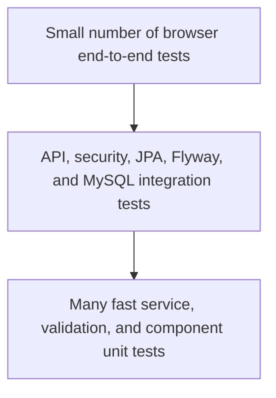

# Testing Strategy

## 1. Objectives

Testing should demonstrate that the system is correct at three boundaries:

1. domain rules behave as intended;
2. authorization prevents cross-user and cross-hospital access;
3. the deployed user flows work through browser, API, and database together.

The project does not need a very large test suite. It needs a focused suite around
high-risk behavior, plus repeatable evidence for the viva.

This document is a strategy and acceptance checklist. It does not claim that the
tests have passed in any environment.

## 2. Test pyramid



Most domain combinations belong in service tests. MySQL-specific constraints and
queries belong in integration tests. Only core user journeys need full browser
tests.

## 3. Backend unit tests

Use JUnit 5 and Mockito where a focused collaborator mock makes the rule clear.
Avoid mocking every Spring class in tests that would be simpler as integration
tests.

### Authentication and provisioning

- new eligible Google identity becomes a patient;
- existing provider subject resolves the same user;
- suspended user cannot establish an application session;
- public input cannot set `REPRESENTATIVE`;
- valid unused invitation provisions the intended representative;
- inactive, mismatched, or already-consumed invitation does not grant
  representative role.

### Patient profile

- birth date must be in the past;
- invalid blood group is rejected;
- contact number length/format constraints are applied;
- patient cannot change role, identity-provider fields, or representative
  assignments;
- booking service rejects an incomplete profile.

### Appointment service

- appointment hospital is derived from the selected doctor;
- unavailable doctor is rejected;
- past start time is rejected;
- time outside working hours is rejected;
- malformed slot boundary is rejected;
- existing active conflict is rejected;
- cancelled appointment no longer blocks a slot where policy permits;
- successful booking derives patient identity from the current user;
- patient can cancel only their own booked appointment;
- completed/cancelled appointment cannot transition to an invalid state;
- elapsed stored `BOOKED` appointments are returned/filtered as effective
  `COMPLETED`, while future bookings remain `BOOKED`;
- `startsAfter` applies the later lower bound when combined with `dateFrom`;
- cancellation reason rules are enforced.

### Representative authorization

- representative can read and update assigned hospital resources;
- representative with a different assignment receives access denial;
- assignment is checked on every target mutation;
- doctor, bed, and appointment mutations create audit events;
- patient role cannot call representative service operations.

### Ambulance request

- request derives patient ownership;
- hospital must exist;
- pickup address and contact number are required and length/format limited;
- new requests are `PENDING` and do not assign/dispatch an ambulance;
- request history returns only the authenticated patient's rows;
- no cancellation, assignment, or status-transition endpoint is currently
  exposed.

## 4. Backend web/security tests

Use Spring MVC test support for controller contracts and Spring Security behavior.

| Scenario | Expected result |
|---|---|
| Public request to protected API | `401` JSON response, not an HTML login page. |
| Patient request to representative endpoint | `403`. |
| Representative request to patient-only booking | `403`. |
| Invalid DTO | `400` and field-safe error envelope. |
| Missing visible resource | `404`. |
| Slot collision | `409` and stable error code. |
| Valid create | `201` and safe response DTO. |
| Unexpected exception | `500` Problem Details, no stack trace in body. |
| Disallowed CORS origin | No credentialed CORS permission. |
| Logout | Server-side session becomes unusable. |

OAuth provider network calls should not be required for ordinary controller tests.
Use a test authentication principal or an isolated provider-client test.

## 5. Repository and database integration tests

The current automated Spring integration suite uses in-memory H2 in MySQL
compatibility mode and executes Flyway migrations. It covers security, OAuth
provisioning, discovery, patient appointment/ambulance ownership, effective
completion, and representative hospital scoping. H2 can still differ from MySQL
in locking, collation, timestamp behavior, and SQL syntax.

Testcontainers dependencies are present for a future MySQL-specific release
suite, but no current test starts a MySQL container. Until that test exists, run
the migration and smoke checks against MySQL 8 before a release or viva and state
that distinction honestly.

### Migration tests

- an empty MySQL database migrates to the current version;
- all foreign keys and unique constraints exist;
- reference seed data is deterministic, sanitized, and contains no real patient
  identity;
- Spring Session schema is present;
- migration checksums are stable.

### Query tests

- specialization search returns correct doctors;
- emergency query requires both matching available beds and doctors;
- bed aggregates distinguish ICU and General;
- patient appointment query never returns another patient;
- representative query returns only assigned hospitals;
- pagination is stable and bounded;
- unsupported sort properties return `400 INVALID_SORT`;
- patient and representative appointment filters apply effective completion and
  `startsAfter` correctly;
- audit lookup orders events consistently.

### Concurrency test target

The current overlap integration test proves that a second sequential booking is
rejected. A MySQL/Testcontainers concurrency test should additionally run two
appointment attempts for the same doctor and slot in separate transactions and
assert:

- exactly one succeeds;
- one returns/causes a conflict;
- exactly one active database row exists afterward.
- both requests use the same pessimistic doctor-row locking path.

That future test would validate the pessimistic lock under real concurrent MySQL
transactions, beyond the current sequential overlap test.

## 6. Frontend tests

Use the frontend's configured test runner and Testing Library-compatible queries.
Test behavior visible to a user rather than implementation details.

### Shared UI

- navigation collapses to a usable mobile menu;
- focus moves into and returns from modal/dialog interactions;
- loading skeleton/status is announced appropriately;
- empty state explains the next action;
- API error envelope maps to a safe message;
- validation errors are associated with fields.

### Authentication and routing

- unauthenticated protected page redirects/offers login;
- patient sees only patient navigation;
- representative sees only representative navigation;
- loading `/auth/me` does not flash the wrong dashboard;
- expired session leads to a clear re-authentication path;
- logout clears client cache after the backend invalidates the session.

### Patient flows

- doctor filters produce the expected query;
- slot list handles loading, empty, and conflict refresh;
- appointment form sends no patient ID;
- cancellation requires confirmation and refreshes the list;
- profile form preserves server validation errors;
- ambulance request distinguishes success from emergency-service guarantees.

### Representative flows

- doctor/bed changes show pending state and server result;
- failed update restores/refetches authoritative state;
- hospital selector contains only assigned hospitals;
- appointment cancellation requires a reason;
- `403` is displayed as access denied, not resource not found.

## 7. End-to-end journeys

Keep browser end-to-end coverage small:

1. **Patient onboarding**
   - authenticate using a controlled test mechanism;
   - complete profile;
   - reload and confirm persistence.
2. **Appointment lifecycle**
   - search for a doctor;
   - choose a slot;
   - book;
   - verify dashboard/list;
   - cancel and confirm status remains in history.
3. **Representative operations**
   - authenticate as representative;
   - select assigned hospital;
   - change bed or doctor status;
   - verify patient discovery reflects the change.
4. **Authorization denial**
   - representative attempts an unassigned hospital resource;
   - API returns `403` and no change is made.

Google itself should not be automated with real personal credentials in CI.
Inject a safe test identity/profile or use an application-supported test security
configuration that cannot be enabled in production.

## 8. Manual exploratory matrix

| Area | Desktop | Narrow mobile | Keyboard only | Slow network | Empty data | Server error |
|---|---:|---:|---:|---:|---:|---:|
| Landing/login | ✓ | ✓ | ✓ | ✓ | N/A | ✓ |
| Patient dashboard | ✓ | ✓ | ✓ | ✓ | ✓ | ✓ |
| Doctor search | ✓ | ✓ | ✓ | ✓ | ✓ | ✓ |
| Appointment booking | ✓ | ✓ | ✓ | ✓ | ✓ | ✓ |
| Ambulance page | ✓ | ✓ | ✓ | ✓ | ✓ | ✓ |
| Representative dashboard | ✓ | ✓ | ✓ | ✓ | ✓ | ✓ |
| Doctor/bed tables | ✓ | ✓ | ✓ | ✓ | ✓ | ✓ |
| Profile | ✓ | ✓ | ✓ | ✓ | N/A | ✓ |

The check marks describe required coverage, not recorded results.

## 9. Accessibility checks

- Run an automated accessibility scan on every main page.
- Navigate all controls by keyboard.
- Verify visible focus.
- Use semantic headings and landmarks.
- Ensure form controls have persistent labels.
- Ensure status does not rely only on color.
- Confirm contrast meets WCAG AA targets.
- Announce asynchronous success/error changes.
- Check tables have headers and usable mobile alternatives.
- Respect reduced-motion settings where animations exist.

Automated tools do not replace manual keyboard and screen-reader spot checks.

## 10. Security test matrix

| Threat/test | Expected defense |
|---|---|
| Patient supplies another patient ID | Endpoint ignores/rejects it and derives current profile. |
| Browser changes stored role | Backend role remains unchanged. |
| Representative changes URL to foreign hospital ID | `403`; no mutation/audit-as-success. |
| SQL-like text in search | Treated as data through parameters/JPA. |
| Overlong notes/reason/location | `400` before persistence. |
| Cross-origin state-changing request | CORS/CSRF policy blocks it. |
| Reused expired session | `401`. |
| Duplicate concurrent booking | One succeeds; one conflicts. |
| OAuth callback with invalid state | Rejected by security framework. |
| Error-inducing request | No secret, SQL, or stack trace in response. |

## 11. Performance checks

The project does not need large-scale load engineering, but it should establish a
reasonable baseline with representative seed data:

- doctor search latency;
- emergency availability aggregation;
- appointment list pagination;
- representative dashboard aggregation;
- concurrent booking correctness;
- backend startup plus migration time.

Use MySQL `EXPLAIN` for the main discovery and appointment queries. Add indexes
only when the plan and measured workload justify them.

## 12. Test data

- Use synthetic names, emails, contacts, and addresses where possible.
- Never commit real Google tokens or session records.
- Give each test its own deterministic fixtures.
- Roll back or recreate database state between integration tests.
- Do not make tests depend on insert order or legacy numeric IDs.
- Keep representative hospital assignments explicit in fixtures.

## 13. Commands and evidence

Typical backend verification:

```bash
cd backend
./mvnw verify
```

Typical frontend verification:

```bash
cd frontend
npm run lint
npm run typecheck
npm test
npm run build
```

For each release/viva candidate, retain:

- commit hash;
- Java and Node versions;
- test command outputs;
- production build outputs;
- Flyway migration version;
- browser/accessibility checklist;
- deployment URLs and verification timestamp;
- known limitations.

Do not write “all tests pass” in permanent documentation without attaching or
linking the corresponding run evidence.

## 14. Acceptance criteria

The candidate is ready for demonstration when:

- both applications build from a clean checkout;
- an empty MySQL database migrates automatically;
- patient and representative flows work with separate accounts;
- ownership and hospital-scope negative tests pass;
- double booking is prevented under concurrency;
- deployment uses environment variables and contains no tracked secrets;
- main pages are responsive and keyboard-usable;
- API/OpenAPI and diagrams match implemented behavior;
- a backup/restore and rollback plan exists;
- known limitations are stated honestly.
