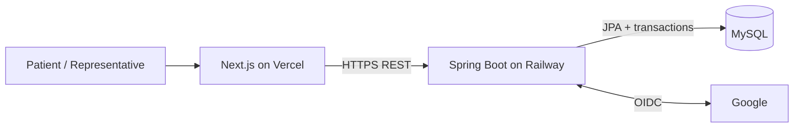

# Final-Year Viva Guide

## 1. One-minute project explanation

> VitaNova Connect is a role-based medical service discovery and operations
> platform. Patients sign in with Google, complete a profile, find doctors and
> hospitals with relevant availability, book appointments, and track ambulance
> requests. Hospital representatives manage doctor and bed availability only for
> hospitals assigned to them. The system uses a responsive Next.js frontend, a
> Java Spring Boot REST backend, MySQL, Flyway migrations, database-backed
> sessions, and deployment on Vercel and Railway. Its key engineering focus is
> secure authorization, relational integrity, transactional booking, and a clean
> modular-monolith architecture.

## 2. Problem statement

The legacy project made useful medical-service data searchable but required a
local Java console/JavaFX application, had no real login or authorization, used
hard-coded database credentials, and contained incompatible schema names across
the Java files and SQL dump.

The modernization solves:

- accessible browser-based use on desktop and mobile;
- verified user identity;
- patient and representative role separation;
- hospital-scoped operational permissions;
- safe appointment lifecycle and concurrency;
- reproducible schema changes;
- deployment and environment configuration;
- testable REST and UI boundaries.

## 3. Scope

### Included

- Google sign-in;
- patient and representative dashboards;
- patient profile onboarding;
- hospital, doctor, bed, and ambulance discovery;
- appointment booking/cancellation;
- representative doctor/bed/appointment operations;
- ambulance request tracking;
- audit events;
- responsive UI, REST API, MySQL migrations, testing strategy, and deployment.

### Explicitly excluded

- diagnosis or treatment advice;
- prescriptions and electronic health records;
- payments and insurance;
- live GPS dispatch;
- public administrator dashboard;
- microservices.

Stating non-goals shows control of scope rather than an incomplete design.

## 4. Architecture talking points

### Why a modular monolith?

- The domain and team size do not justify distributed services.
- One deployable backend keeps transactions and debugging simple.
- Package-by-feature boundaries still demonstrate modular design.
- It can be split later only if measured scale/ownership needs appear.

### Why separate frontend and backend?

- Next.js provides the modern responsive user experience and Vercel deployment.
- Spring Boot preserves Java and demonstrates REST/security/service/repository
  architecture.
- The API boundary makes responsibilities and authorization testable.

### Why MySQL?

- It preserves the original DBMS learning objective.
- The domain is strongly relational.
- Foreign keys, transactions, unique constraints, joins, and indexes directly
  support the requirements.

## 5. Database concepts to explain

### Normalization

- `users` stores identity and role.
- role-specific fields are in `patient_profiles` and
  `representative_profiles`.
- hospital authorization uses the many-to-many
  `representative_hospitals` table.
- appointments reference patient, doctor, and hospital instead of duplicating
  their details.

### Keys and integrity

- primary keys uniquely identify records;
- foreign keys preserve valid relationships;
- unique constraints protect email/provider identity, bed codes, vehicles, and
  appointment-slot integrity;
- check/application constraints preserve allowed times and states.

### Indexing

Explain each index through a query:

- specialization/status for doctor search;
- hospital/ward/status for bed counts;
- doctor/start/status for slot availability;
- patient/start for patient timeline;
- representative/hospital for authorization scope.

Too many indexes slow writes, so indexes are chosen from actual access paths and
checked with `EXPLAIN`.

### Transactions and concurrency

Appointment booking is not:

1. check availability;
2. assume it remains free;
3. insert later.

The service pessimistically locks the doctor row, checks active overlaps, and
inserts inside one transaction. A second booking for that doctor waits and then
observes the first committed appointment, so exactly one succeeds.

## 6. Authentication versus authorization

This distinction is a frequent viva question:

- **Authentication** answers “Who is this user?” Google OIDC proves identity.
- **Authorization** answers “What can this user do?” The application's database
  role, ownership, and hospital assignments decide.

The frontend may hide menus, but it is not trusted. A patient who manually calls
a representative endpoint still receives `403`.

### Representative role assignment

- Patients may be created on first eligible Google sign-in.
- Users cannot select representative role.
- A representative is pre-authorized through an invitation/allowlist and assigned
  hospitals.
- Every representative resource operation rechecks the assignment.

This prevents privilege escalation.

## 7. Session explanation

- Spring Security completes Google OAuth.
- The backend creates a server-side session stored through Spring Session in
  MySQL.
- The browser holds only an opaque `HttpOnly` session cookie.
- `Secure`, `SameSite`, CORS, and CSRF settings protect browser use.
- Logout invalidates server state.
- Database backing allows the session to survive a backend process restart.

Do not say that OAuth itself assigns application roles; it supplies identity
claims.

## 8. REST design talking points

- `/api/v1` provides explicit versioning.
- nouns identify resources: `/doctors`, `/appointments`, `/hospitals`.
- methods express actions: `GET`, `POST`, `PATCH`.
- request/response DTOs prevent persistence entities from becoming the API.
- `400`, `401`, `403`, `404`, `409`, and `500` have distinct meanings.
- error codes are stable and safe.
- pagination limits growing lists.
- patient ID is derived from the session, not accepted as trusted input.

### Why `PATCH .../cancel` rather than delete?

Cancellation is a business state transition. Keeping the row preserves patient
history, representative accountability, and auditability.

## 9. Business rules worth demonstrating

- appointment must be in the future;
- doctor must be available;
- appointment is inside working hours;
- doctor belongs to selected hospital;
- no active slot conflict;
- patient owns the appointment being cancelled;
- representative is assigned to target hospital;
- doctor/bed changes create an audit event;
- ambulance request belongs to current patient;
- terminal statuses cannot transition arbitrarily.

## 10. Legacy-to-modern comparison

| Before | After |
|---|---|
| Console and partial JavaFX | Responsive Next.js web UI |
| Menu role selection | Google identity plus server-owned role |
| Static JDBC and unmanaged `ResultSet` | Services, repositories, DTOs, transactions |
| Inconsistent table names | Flyway-managed canonical schema |
| Hard-coded credentials | Environment variables |
| Delete on cancellation | Lifecycle status and audit |
| No authorization | Ownership and hospital scope |
| Manual local setup | Container/cloud deployment guides |
| No tests | Focused unit, integration, security, and end-to-end strategy |

Keep legacy artifacts in the demonstration to show the evolution and specific
problems solved.

## 11. Suggested demonstration

### Preparation

- use synthetic patient and representative Google accounts;
- seed at least two hospitals and assign the representative to only one;
- have a free doctor slot and a known bed state;
- open frontend, backend health, Swagger/OpenAPI, and database viewer;
- use a clean browser profile for each role;
- prepare a fallback screen recording/screenshots for network/OAuth failure.

### Ten-minute flow

1. **Landing page (30 seconds)**
   - explain the product and two roles.
2. **Patient login/profile (1 minute)**
   - Google sign-in and server-resolved role.
3. **Discovery (1.5 minutes)**
   - filter a doctor; show hospital/bed availability.
4. **Appointment (2 minutes)**
   - inspect slots, book, show dashboard, cancel without deleting history.
5. **Representative (2 minutes)**
   - switch account; show assigned hospital; update doctor/bed.
6. **Security (1 minute)**
   - show a `403` for an unassigned resource or patient-only role.
7. **Technical view (1.5 minutes)**
   - architecture diagram, ER model, Swagger, Flyway history, and audit record.
8. **Close**
   - limitations and a realistic next step.

Do not spend demonstration time scrolling through source files unless asked.

## 12. Likely viva questions and answers

### Why Spring Boot instead of keeping JDBC?

The project retains Java and SQL concepts but replaces duplicated connection and
resource handling with dependency injection, repositories, declarative
transactions, validation, security, and consistent REST errors. JPA does not
remove SQL knowledge; complex queries and indexes still require relational
reasoning.

### Why not use microservices?

There is one cohesive domain, one student team, one database, and no independent
scaling/deployment need. A modular monolith is easier to transact, test, deploy,
and explain. Microservices would add network failure, distributed consistency,
and operations without product benefit.

### Why Google OAuth?

It delegates password handling and primary identity proof to a mature provider.
The application still controls roles, profile data, session lifetime, and
authorization.

### Can a patient become a representative by changing browser data?

No. Browser state is not authoritative. The backend loads the role from the
database, and representative access additionally requires a hospital assignment.

### How do you prevent double booking?

The service obtains a pessimistic lock on the doctor row, validates the slot, and
inserts inside one transaction. A concurrency integration test starts two
attempts and proves only one active appointment remains.

### Why store hospital ID on the appointment if the doctor has a hospital?

It records the booking location explicitly and supports efficient hospital
operations/history. The service validates that it matches the doctor's current
hospital at booking time. In a larger design, doctor-hospital schedules could be
modeled separately.

### Why individual bed rows rather than a count?

Individual rows support identifiable status changes, constraints, and audit.
Availability is derived with an aggregate query. A pure count is simpler but
cannot explain which bed changed.

### What does Flyway solve?

It versions schema evolution. A clean database can reach the same state in a
known order, and deployed environments record which migrations ran. It avoids
manual schema drift.

### What is the difference between `401` and `403`?

`401` means authentication is missing or expired. `403` means identity is known
but the role/ownership/assignment does not allow the action.

### Why are entities not returned directly?

DTOs prevent accidental disclosure, avoid lazy-loading/serialization problems,
and decouple the API contract from database columns.

### Why database-backed sessions instead of local storage tokens?

The browser receives an opaque HttpOnly cookie that JavaScript cannot read.
Server-side session invalidation supports logout/revocation, and database backing
survives process restart. Cross-origin cookie/CSRF configuration must be handled
carefully.

### How is SQL injection prevented?

Queries use JPA/parameter binding; dynamic sort fields are allowlisted; raw user
input is never concatenated into SQL.

### Is the system HIPAA/GDPR compliant?

No certification is claimed. The design applies data minimization, access
control, secrets management, audit, and retention principles, but formal
compliance requires legal scope, policy, infrastructure controls, contracts,
incident response, and independent assessment.

### What would you improve next?

A realistic next phase is verified hospital onboarding and notifications, then
same-site custom domains and stronger operational monitoring. Live GPS,
payments, or microservices would be considered only with validated requirements.

## 13. Testing explanation

Describe the pyramid:

- unit tests for rules and state transitions;
- current H2/MySQL-mode Spring integration tests for migrations, security,
  ownership, filters, and API behavior;
- current Vitest coverage for the frontend API client and utilities;
- MySQL Testcontainers concurrency coverage as a clearly identified future
  release-hardening test;
- manual browser journeys for OAuth and responsive role flows.

The most important negative tests are cross-patient access, unassigned-hospital
access, invalid OAuth provisioning, and concurrent booking.

Never claim “100% tested.” Explain what was tested, why it was prioritized, and
show the actual command/report for the candidate revision.

## 14. Deployment explanation

- Vercel builds the Next.js frontend.
- Railway builds/runs the Spring Boot backend.
- Railway MySQL is accessible to the backend through environment/reference
  variables.
- Google redirects to the backend OAuth callback.
- Vercel browser calls the Railway API through HTTPS with credentials.
- Flyway migrates schema.
- `/actuator/health` supports deployment readiness.
- secrets live in platform configuration.

Mention that cross-site cookie behavior is a known deployment concern and
same-site custom subdomains are the preferred polished arrangement.

## 15. Diagrams to include in the report

1. system context/deployment diagram from `architecture.md`;
2. backend component diagram;
3. ER diagram from `database-schema.md`;
4. Google sign-in sequence;
5. appointment booking sequence;
6. representative scoped-update sequence.

Each diagram should answer one question. Avoid placing the complete class diagram
and database schema on one unreadable slide.

## 16. Final report chapter structure

1. Abstract
2. Problem statement and objectives
3. Existing system analysis
4. Requirements and scope
5. Architecture and technology choices
6. Database design and normalization
7. Module and API design
8. Authentication and security
9. Implementation highlights
10. Testing and results
11. Deployment
12. Limitations and future work
13. Conclusion
14. References and appendices

## 17. Honest limitations

- availability is updated by representatives, not verified from hospital systems;
- ambulance location is human-readable, not live GPS;
- Google is the only identity provider;
- representative provisioning requires a trusted operator;
- no notifications or reminders are guaranteed;
- cross-site cookie behavior may vary with browser privacy settings;
- no formal healthcare compliance certification;
- no administrator UI;
- demonstration data is synthetic/sanitized.

Honest limits strengthen the engineering case because they distinguish delivered
scope from future work.

## 18. Presentation checklist

- [ ] Use the same product name everywhere.
- [ ] State the two roles and non-goals early.
- [ ] Show one clean architecture diagram.
- [ ] Explain authentication versus authorization.
- [ ] Explain one transaction/concurrency example.
- [ ] Demonstrate a negative authorization case.
- [ ] Show Flyway/OpenAPI/audit evidence.
- [ ] Use synthetic accounts/data.
- [ ] Keep backup demo material available.
- [ ] State actual test/deployment status accurately.
- [ ] End with limitations and one realistic next step.
